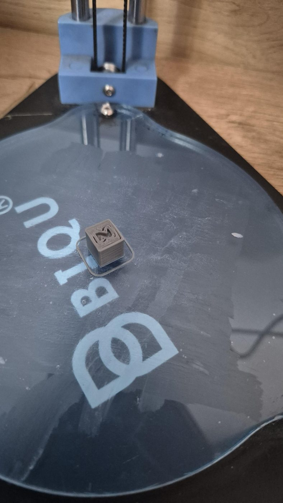

# BIQU Magician 3D Printer

Notes, photos and a small tool for reviving a second-hand **BIQU Magician** delta 3D printer: stock Smoothieware on an LPC1768 board, a BIGTREETECH 2.8" touchscreen, and no probe switch fitted (the plug for one is there).

## Guides

- **[Reviving a BIQU Magician](docs/reviving-the-magician.md)**: what's inside (with photos), why USB ignores commands and how to fix it, the missing SD card, calibrating the delta with a paper test over USB without a probe, a fan-wiring warning, and probe and Klipper notes.
- **[Replacing the linear bearings](docs/bearing-replacement/README.md)**: rescuing a rusty Magician with seized carriages, step by step with photos ([PDF version](docs/bearing-replacement/biqu-magician-bearing-replacement.pdf)). Key findings:
  - The carriages use **LM8LUU (8 × 15 × 45 mm)** bearings. A single LM8UU per rod, centered, works as a stopgap.
  - The top housing is **press-fit** on the rods and lifts straight off. Don't remove the feet.
- **[Calibration notes](docs/calibration.md)**: recalibrating after reassembly, over USB with the stock firmware or with Klipper.

## Contents

- `docs/`: guides, setup, calibration and maintenance notes
  - [`docs/images/`](docs/images/): photos of the board, screen, extruder, bed and SD slot
- [`tools/printer_link.py`](tools/printer_link.py): keeps one USB serial connection open (so the board isn't reset between commands) and sends G-code from the command line. It can also print a sliced G-code file. Needs Python 3 and `pyserial`.
- [`models/calibration-cube/`](models/calibration-cube/README.md): the 10 mm reference cube (file fingerprint, settings and results) for comparing stock Smoothieware with Klipper later.
- Planned: `firmware/` (firmware builds and configuration), `slicer-profiles/` (slicer settings), more `models/` (printable parts and upgrades)

## Quick start (USB)

```
pip install pyserial
python tools/printer_link.py probe COM3                # find the baud rate, identify the firmware
python tools/printer_link.py serve COM3 --baud 115200  # leave running
python tools/printer_link.py send M503                 # in another terminal
```

Unplug the touchscreen's serial cable first, or the printer will ignore USB commands.

## Status

**It prints.** The bearing replacement is done, the printer has been calibrated over USB with the stock firmware (paper test), and the extruder steps/mm are checked. The first print, a 10 mm calibration cube in PLA over USB (sliced in Cura, glue stick on the acrylic bed), came out true to size with sharp letters ([details and settings](docs/reviving-the-magician.md#first-print)).



A second print, a 40 mm figure with tree supports, also came out fine ([settings](docs/reviving-the-magician.md#second-print-a-small-figure-with-supports)). The probe wiring is already on the board: the plug by the nozzle block is the probe input, so a normally-open lever microswitch on it should work with the stock firmware ([how we found it](docs/reviving-the-magician.md#adding-a-probe)). `config-get` also gave the full stock pin map for a later Klipper config.

Next: a glass bed surface, a removable microswitch probe and mount, and possibly Klipper.

## License

Guides and photos in `docs/` are licensed [CC BY-SA 4.0](docs/LICENSE).
