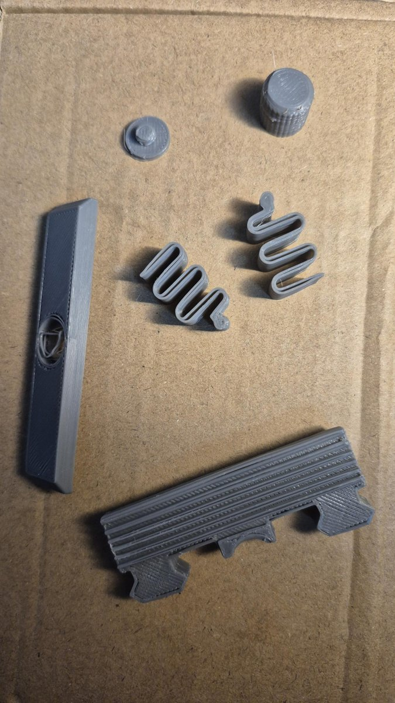

# Assorted prints (2026-11-26)

Printed after pressure advance (0.55) and the first-layer fixes.

- **Zigzags:** very clean. The thin walls stayed separate, the curves are smooth, with only light stringing inside the loops. Good cooling and retraction.
- **Bar (left):** smooth sides and sharp edges. The hole in the middle is messy, with loose loops inside (bridging over air). Use supports there, or reorient the part.
- **Knurled cap:** even ridges. The top is a bit rough, with a blob on the edge. Add one more top layer and slow the top surface.
- **Small button:** fine. The tiny top detail is slightly blobby, which is normal at that size.
- **Ridged piece:** clean, parallel top ridges. The edges of the feet are rough (first layer or overhang).

**Verdict:** the printer is in good shape. What remains is small-feature detail (tiny tops, holes over air), not calibration.
