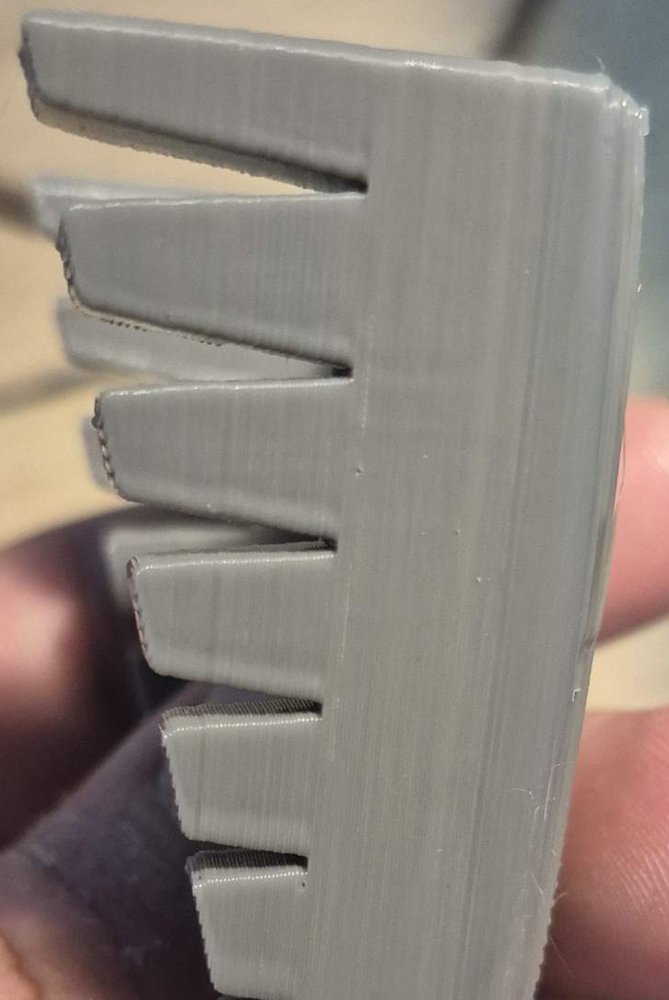
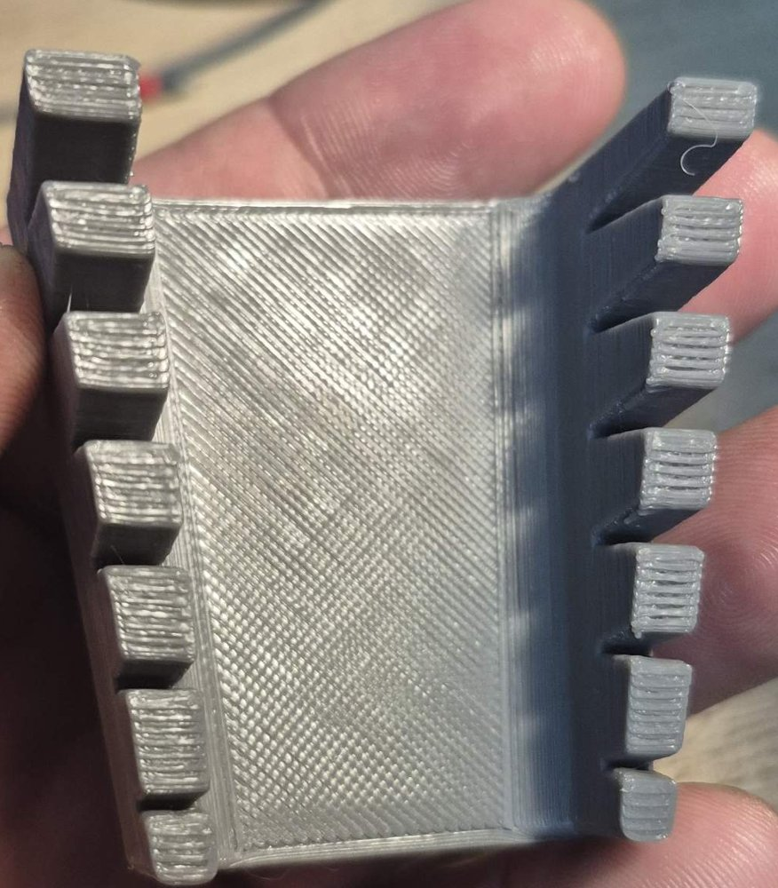
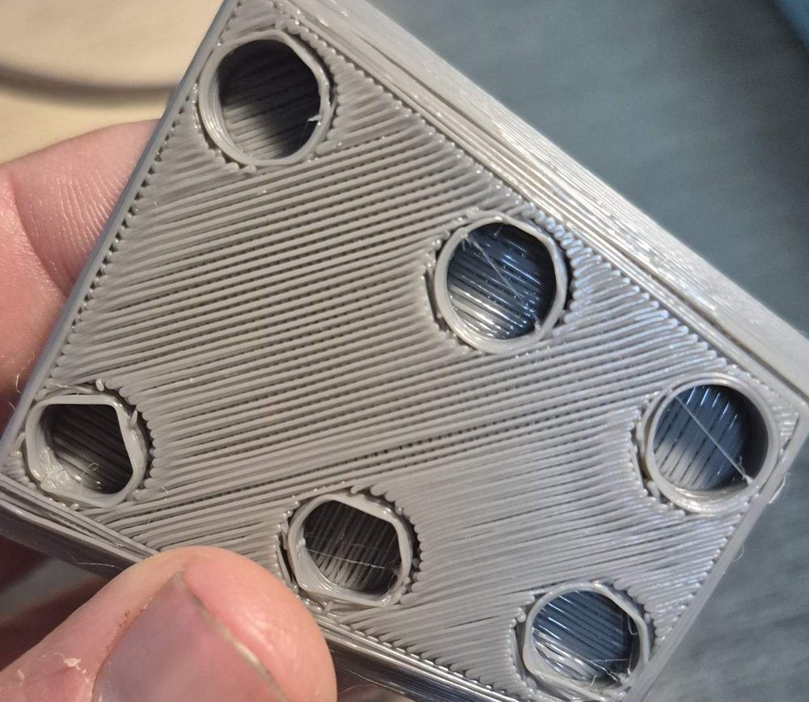
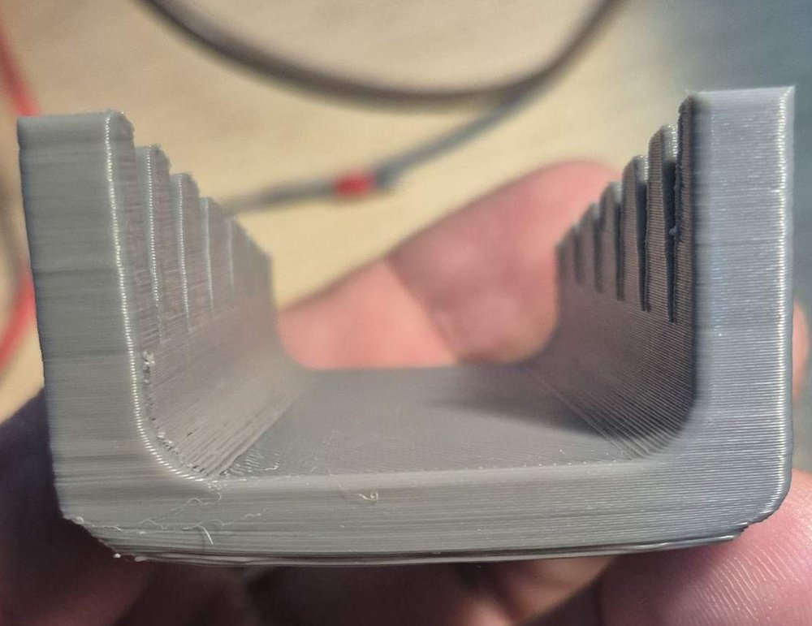
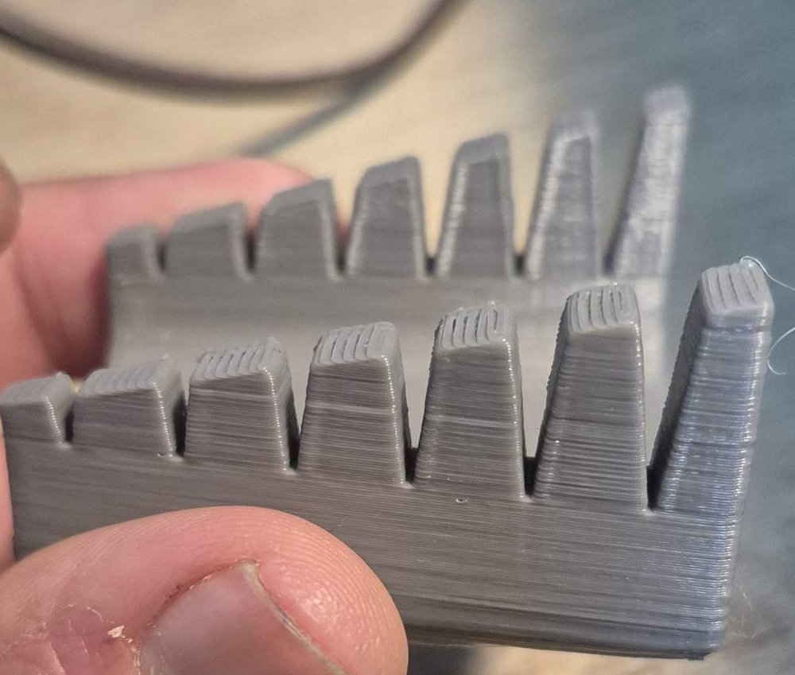

# Soldering cable holder

A U-shaped holder with two rows of slanted, tapered fins to hold soldering-iron and test-lead cables. Printed on the Magician (Klipper, glass bed, pressure advance 0.55).

| | |
|---|---|
|  |  |
|  |  |

**Result:** good.
- Walls and the inside radius of the U are smooth, and the fins are cleanly separated, with only an odd hair of stringing. The first print after setting `pressure_advance: 0.55`.
- Tall, thin fin tips are a bit rough on their last layers (small layers, little cooling time). This is normal; a minimum layer time of about 10 s would tidy it.
- The bottom face (six holes) shows visible top-surface lines and some slightly out-of-round holes with small strings across them. Fine for function. One more top layer, or a slower top surface, would close it up.
