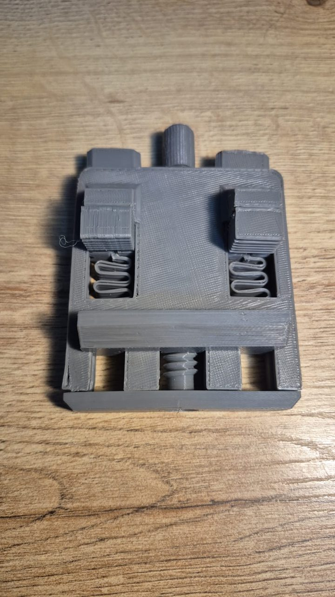
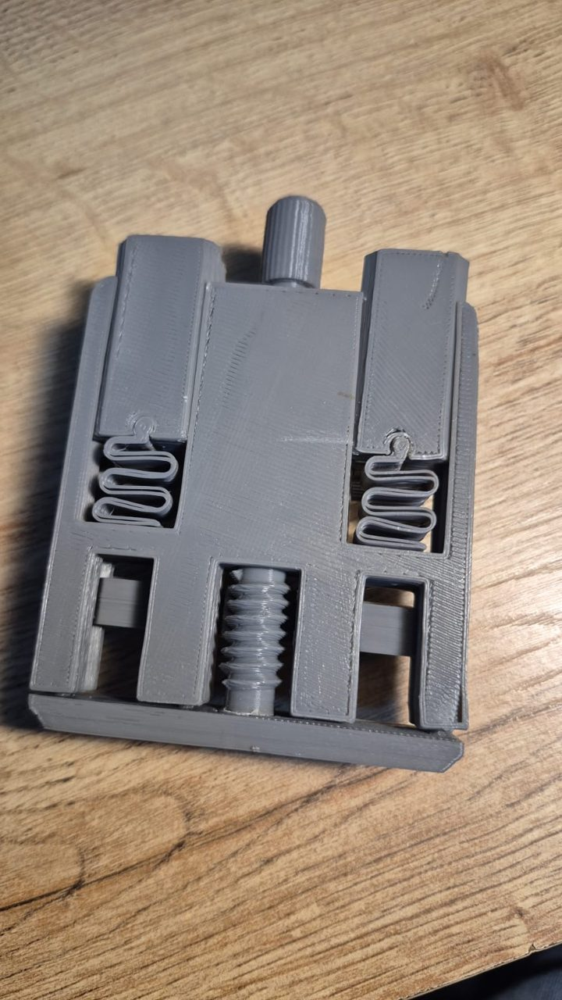
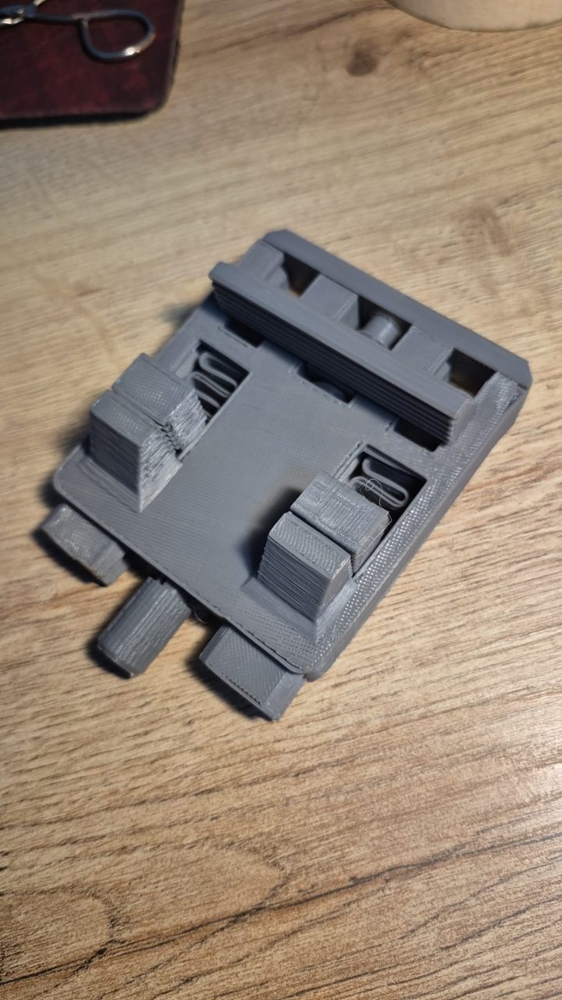
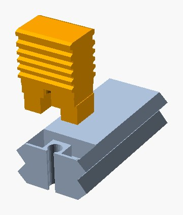

# SolderMate soldering vise, shortened

A shortened version of the **SolderMate** soldering vise by **Leonic** (CC BY-NC 4.0), sized to fit the Magician's bed. It holds small boards like an ESP32 or Raspberry Pi Pico between the screw jaw and the fixed blocks. The two spring-loaded jaws hold cables. Printed in PLA on the Magician (Klipper, glass bed, pressure advance 0.50), at 45 mm/s.

| | | |
|---|---|---|
|  |  |  |

**Result:** assembled and working. It took the original base and small parts, a reprinted screw and a repaired slider (see below).

## Prints

| File | Parts | Slicer estimate | Actual |
|---|---|---|---|
| `soldermate_others_v45_outer25` | moving jaw, end bar, small parts | 1 h 29 min | 1 h 34 min |
| `soldermate_screw_longknob` | long knob (a community remix; the stock knob is short) | 1 h 57 min | 2 h 03 min |
| `soldermate_base_v45_fix2` | base with the two print-in-place sliders | 3 h 59 min | 4 h 12 min |
| `soldermate_slider_peg_fittest` | peg fit test for the slider repair | 15 min | 17 min |
| `soldermate_slider_2part` | new slider body plus jaw tab | 1 h 08 min | 1 h 12 min |
| `soldermate_screw_v2_split` | screw, shortened correctly | 1 h 44 min | 1 h 47 min |

The base fits inside the 105 mm safe circle (see [tower calibration](../tower-calibration.md)). Its middle-layer infill was raised to 55 mm/s in the file. Walls, the first layer and top layers stayed at the normal speed.

## Problems and fixes

### Purge line cancelled the print
The first base file (`soldermate_base_v45_fix`) stopped at the purge line. Klipper's `max_extrude_cross_section` defaults to **0.640 mm²**, and the purge line needed 0.689 mm². Three thinner purge lines (0.528 mm² at most) fixed it. **Check every extrusion move against this limit**, including hand-written purge lines, not only the sliced part.

### Print-in-place sliders fused at the top
The sliders print inside the base. Their side clearances were fine, but the frame "ceiling" above each slider ledge was only 0.3 mm in the design. At 0.2 mm layers that rounds to one layer (about 0.4 mm as printed), and the ledge bonded to the ceiling. Tapping the sliders freed them, but one jaw tab broke while being pried out.

Lessons:
- Check **vertical** gaps (ceilings and bridges) as well as side gaps.
- Design gaps snap to the layer height. At 0.2 mm layers, 0.3 and 0.4 mm gaps slice exactly the same. Check the sliced layers, not only the model.
- A version with 0.6 mm gaps was prepared but not needed, because of the repair below.

### Repaired slider: printed in two parts
The new slider keeps the original size and shape. Only the way the jaw tab attaches changed:
- The body is cut at z 11.0 mm. A cut at exactly z 10.9 left a paper-thin sliver.
- The tab joins the body with two 5 mm pegs (0.2 mm clearance), widened and joined by a U-shaped bridge behind the spring slot.
- The tab **prints on its side**. Its back has a 1 mm step, so it cannot lie flat on its back.
- The pegs were checked first with a 17 min fit test. They fit snugly. The tab was then glued in with super glue.

### Screw would not go in
When the vise was shortened, the cut was taken out of the screw's plain shaft. That made the shaft (24 mm) shorter than the 50 mm tunnel it passes through, so the threads hit the tunnel. Screw v2 instead removes **22 thread pitches**: thread z 5–22, plain shaft z 24–82.9, 82.9 mm in total. The thread runs in the open channel at the jaw end, the plain shaft runs through the tunnel, and the knob sits at the spring-jaw end.

**Rule for shortening a screw:** take length out of the thread, never out of a plain section that has to span a fixed part.

### Long knob
The long knob went on with force. Light sanding is enough if it is too tight.

## Notes
- The OpenSCAD source and STLs for the shortened parts are kept outside this repo. The original design is CC BY-NC 4.0, so any shared remix must credit Leonic and stay non-commercial.
- An ESP32 fits between the jaws (fit-tested before assembly). It has not been used for a full soldering session yet.
