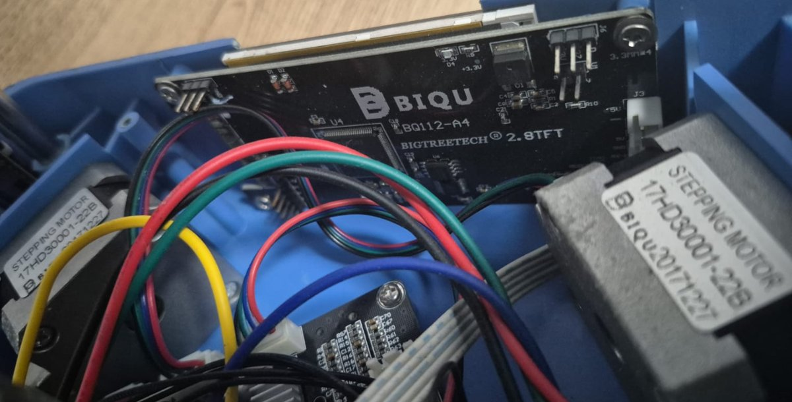
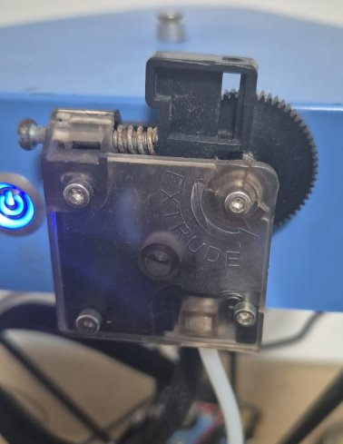
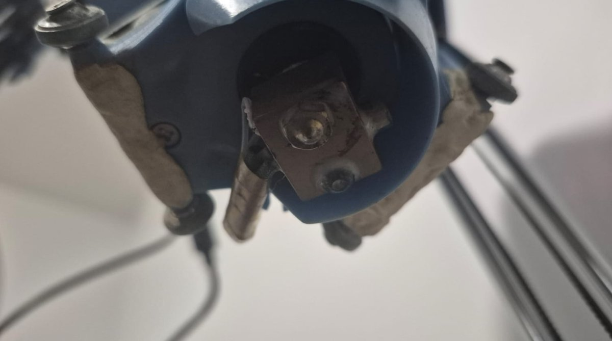
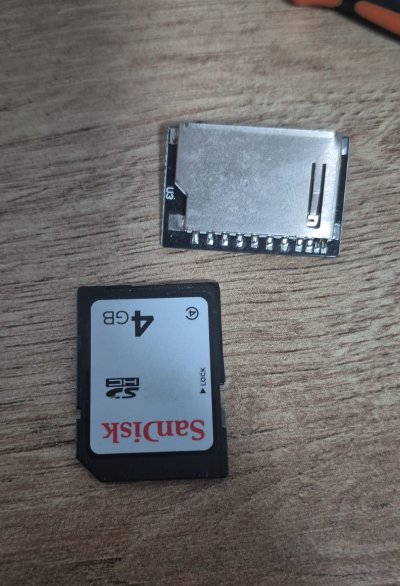
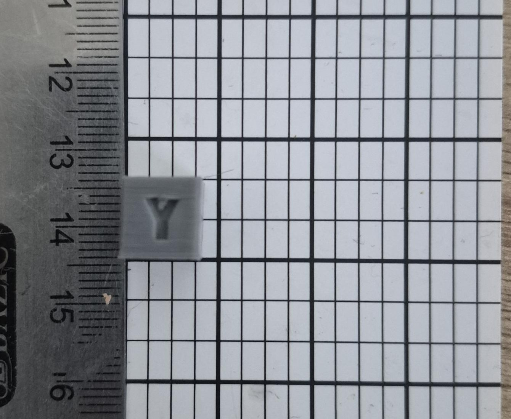

# Reviving a BIQU Magician

Notes from bringing a second-hand BIQU Magician delta printer back to life: what's inside, why USB seems dead, and how to calibrate it without a probe or an SD card. Findings come from one unit with stock firmware, so check them against yours. If the carriages are rusty or seized, start with [Replacing the linear bearings](bearing-replacement/README.md). For a shorter calibration overview, including the Klipper route, see [Calibration notes](calibration.md).


## What's inside

| Part | On our unit |
|---|---|
| Mainboard | BIQU **BQ111-A6**, NXP **LPC1768** (100 MHz), stepper drivers soldered on under heatsinks |
| Firmware | **Smoothieware**, build `~11myvar2`, dated Apr 11 2018 (not Marlin) |
| USB | **CP2102** USB-to-serial chip, **115200 baud** |
| Touchscreen | **BIGTREETECH 2.8" TFT**, board **BQ112-A4**: a separate controller talking to the mainboard over serial |
| Extruder | Titan-style geared bowden extruder, `M92 E395` |
| Bed | Round acrylic plate, about **100 mm** across, unheated, screwed flat to the base (no leveling springs) |
| Probe | **None**, although the firmware's probe module is enabled |







## Getting USB to work

1. **Driver.** On Windows the CP2102 shows up as "CP2102 USB to UART Bridge Controller" with an error until you install the **Silicon Labs CP210x** driver. Linux has it built in (`/dev/ttyUSB0`).
2. **Unplug the touchscreen's serial cable.** The screen and the USB chip share the mainboard's serial line. With the screen connected, you'll see `ok T:22.0 /0.0 @0` every 3 seconds (the board answering the screen's temperature polls), and **every command you send over USB is ignored**. With the printer off, unplug the cable from the screen board (the white connector next to the "5V" label, J3 on ours). After that, USB accepts commands normally. The screen stays dark, which is expected.
3. **Opening the port resets the board** (one of the CP2102's control lines drives reset). Homing is lost on every new connection, so keep one connection open for a whole session. [`tools/printer_link.py`](../tools/printer_link.py) does that.
4. **M115 returns only `ok`** on this Smoothie build. Use `version` to identify it.

## The SD card situation

- The slot on the side of the screen housing belongs to the **touchscreen board**, not the mainboard. On our unit the socket had **broken off** the screen board. That only affects printing from a card through the screen.
- **No SD card was found on the mainboard.** Smoothie runs on settings built into this firmware build (`M503` starts with `; No config override`), and **`M500` has nowhere to save**. Calibrated values have to go in the slicer's start G-code.




## Stock settings (from M503 on our unit)

```
M665 L146.03 R61.7     ; arm length, delta radius
M666 X0 Y0 Z0          ; endstop trims: all zero, never calibrated
M665 Z150              ; max height
M92 X100 Y100 Z100     ; steps/mm (checked with a tape measure: correct)
M92 E395               ; extruder steps/mm
M301 P22.2 I1.08 D114  ; hotend PID (holds 200 °C within about 1 °C)
```

Expect the max height to be well off: it can be more than 10 mm out, so approach the bed carefully the first time. After `G28`, Smoothie reports a Z about 4 mm below the max-height value, because the carriages back off the endstops.

## Calibrating without a probe

Marlin's `G33` doesn't exist in Smoothie. Smoothie's own `G32` needs a probe, and the Magician has none. A paper test over USB works well. Do it with the screen unplugged and the printer homed.


**Points.** Use the center plus the three towers at **30 mm** from center: front-left (X-26 Y-15), front-right (X26 Y-15), back (X0 Y30). Moves of 40 mm or more toward the back pushed our nozzle past the bed edge, and the arms grind there.

**Routine at each point.** Move sideways at a safe height, go down to about 2 mm above the expected bed, then step down 0.25 / 0.1 mm with a sheet of paper under the nozzle until light drag. Note Z and lift. Negative Z values are fine at this stage, since the height is fixed last.

**Order of corrections (Smoothie):**
1. **Tower trims (`M666 X Y Z`, X = front-left, Y = front-right, Z = back).** Smoothie expects trims ≤ 0. The tower where the bed is met soonest (highest Z reading) keeps 0, and the others get negative trims. Trims take effect at the next `G28`. **One mm of trim corrected only about 0.5 mm of difference** on ours, so scale the second round up. Three rounds got all towers within 0.05 mm.
2. **Delta radius (`M665 R`)**, only if the center differs from the towers once they agree. On ours the stock 61.7 was already fine.
3. **Max height (`M665 Z`).** Subtract the center's light-drag Z from the current value (for example, drag at Z -10.0 with Z150 gives Z160). Home again and check that light drag is at Z 0.

The touchscreen's Move menu (X/Y/Z, steps of 0.1 to 50 mm) works for jogging, but it shows no coordinates. You'd have to count presses, which is why the USB route is easier.


## Fans: important

On our unit **all three fans, including the heatsink fan above the nozzle, are on the switched fan output** (`M106`/`M107`). They do not come on by themselves when the hotend heats. The heatsink fan must run whenever the hotend is hot, or you risk jams and softened plastic parts. Until it's rewired to always-on 12 V or a separate output:

- start G-code begins with `M106 S255`, before any heating;
- slicer fan: 100% from the first layer, minimum 100%, no "fan off for the first layers" option;
- after a print, leave the fans on until the hotend is below 50 °C, then `M107`.

## Start G-code template

Fill in your own calibrated values:

```
M106 S255                  ; fans on first (heatsink fan shares this output)
M665 L146.03 R61.7 Z<your max height>
M666 X<trim> Y<trim> Z<trim>
G28
```

Print from a computer over USB (OctoPrint, Pronterface, Cura) with the screen unplugged.

**Cura notes.** There's no Magician profile: add a *Custom FFF printer* with a 100 × 100 mm **elliptic** bed, **origin at center**, no heated bed, G-code flavor **Marlin** (Smoothie accepts it), and set the extruder's **material diameter to 1.75** (it defaults to 2.85). Cura puts its own `M107` (fans off) just before your end G-code, so start the end G-code with `M106 S255` to keep the heatsink fan running while the nozzle cools. Recent Cura versions also hide USB printing: tick **Preferences → General → Enable USB-cable printing** and restart Cura, otherwise you only get "Save to Disk". Keep Cura open until the nozzle has cooled, because disconnecting can reset the board and stop the fans.

**Without a host program**, `python tools/printer_link.py print COM3 file.gcode` streams a saved file line by line, then keeps the fans on until the nozzle is below 50 °C. Creating a file named `stop_print` next to the tool stops it cleanly (heater off, fans on, nozzle lifted). Use PLA only: the bed is unheated. Painter's tape, glue stick on glass, or a self-adhesive PEI sheet all work. After adding a bed surface, lower `M665 Z` by its thickness and redo the center paper check.

**Cleaning the acrylic bed:** use warm water and dish soap. Avoid isopropyl alcohol and strong degreasers, which can cause fine cracks (crazing) in acrylic, especially around stressed spots like screw holes.

## First print

After the bearing replacement and the paper-test calibration, the first print was a **10 mm XYZ calibration cube** in gray PLA, on a thin layer of washable glue stick.


**Slicer settings that worked:**

| Setting | Value |
|---|---|
| Printer | Delta, round bed about 100 mm across, origin at the center |
| Nozzle / filament | 0.4 mm / 1.75 mm PLA |
| Layer height | 0.2 mm |
| Temperature | 210 °C (215 °C first layer) |
| Bed temperature | 0 (unheated, so the slicer doesn't wait for a bed) |
| Fan | 100% from the first layer |
| Retraction | 3–4 mm (bowden) |
| Adhesion | 2-loop skirt to prime the nozzle |

**Result:** it stuck well, the skirt came out as one even line, and the walls and the embossed X and Y letters are clean. All three axes measured the same, close to 10 mm, measured with a ruler and photos (calipers will give a finer number). Only the top "Z" is messy. That's typical of a 10 mm cube, where each top layer takes a few seconds and doesn't cool before the next. Setting a **minimum layer time of about 10 seconds** in the slicer helps with small parts.




> **Don't print downloaded G-code.** G-code only works on the printer it was sliced for. Files made for other printers (for example a Prusa MK3S) move far outside the Magician's ±50 mm reach from the bed center, wait for a heated bed it doesn't have, and use fan settings that are unsafe here. Always slice the model file (STL) with your own settings.

## Adding a probe

The firmware's probe module is enabled (`M119` shows `Probe: 0`), and **the probe wiring is already there**: a loose **2-pin plug next to the nozzle block** (about 3.3 V across its pins with the printer on). Bridging its two pins flips `M119` to `Probe: 1`. Only the switch itself is missing.

- The firmware reads the probe on **P1.28, inverted with pull-up** (`1.28!^`), so it expects a switch that is **open at rest and closes when pressed**. Wire a lever microswitch's **C and NO** terminals to the plug, **not NC**, or the probe reads "triggered" all the time. The setting can't be changed without an SD card.
- A probe that sits below the nozzle would drag across prints, so make it **removable** (clip or magnet on the nozzle block) and take it off before printing.
- The stock leveling mode is **three-point leveling**: `G32` probes three points and compensates for bed tilt; it does **not** calculate tower trims or delta radius. `G30` (a single probe) works for checking heights at the towers.
- **Inductive sensors won't work** on the acrylic bed, and **BLTouch needs config changes**, which need an SD card.

**Reading the stock config without an SD card:** Smoothie's `config-get <setting>` answers over USB with the value built into the firmware (for example `config-get zprobe.probe_pin`, `config-get alpha_step_pin`). It prints a `cached:` line and no `ok`. On our unit: steppers step P2.0–P2.3, endstops P1.25/P1.27/P1.29 (max, homing up), heater P2.7, thermistor P0.24 (EPCOS 100K), fan P2.4, probe P1.28. That's the pin map a Klipper config needs.

There's also a loose **3-pin connector on the nozzle block's cable bundle** that may be the factory probe plug. That's unverified, so check its pins with a multimeter and the `M119` test before plugging anything into it.

**Planned switch:** a subminiature **lever microswitch with three terminals (C, NO, NC)**, such as Steren's SS0505A. Wire C to ground and NO or NC to the signal pin, depending on what the `M119` test shows the firmware expects. On a delta, the probe has to be removable, or retract above the nozzle, so it doesn't drag on prints. Its X/Y/Z offset from the nozzle can be set with `M565` in the start G-code.

## Klipper?

The LPC1768 is supported by Klipper. Without a mainboard SD card, flashing would go through the chip's built-in serial bootloader (ISP) or SWD:

- A read-only test showed **the CP2102's control lines reset the board but are not wired to the ISP pin (P2.10)**, so ISP can't be entered from USB alone.
- There's an unidentified 2-pin header next to the MCU that might be an ISP jumper. **Unverified: don't bridge it until you've confirmed what it is.**
- Klipper would also need a Linux host, and the stock touchscreen would no longer work.

## Tool

[`tools/printer_link.py`](../tools/printer_link.py) keeps one serial connection open and lets you send G-code from short commands. It ignores the touchscreen's temperature chatter and reopens the port if the printer is power-cycled. Run it with Python 3 and `pyserial`; see the docstring for usage.
