# Reviving a BIQU Magician

Notes from bringing a second-hand BIQU Magician delta printer back to life: what's inside, why USB seems dead, and how to calibrate it without a probe or an SD card. Findings come from one unit with stock firmware, so check them against yours. If the carriages are rusty or seized, start with [Replacing the linear bearings](bearing-replacement/README.md). For a shorter calibration overview, including the Klipper route, see [Calibration notes](calibration.md).

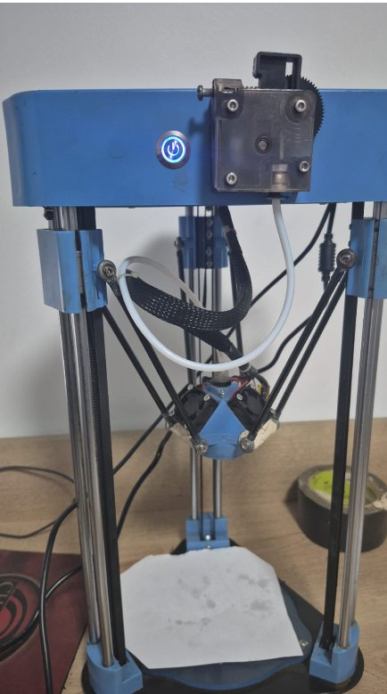

## What's inside

| Part | On our unit |
|---|---|
| Mainboard | BIQU **BQ111-A6**, NXP **LPC1768** (100 MHz), stepper drivers soldered on under heatsinks |
| Firmware | **Smoothieware**, build `~11myvar2`, dated Apr 11 2018 (not Marlin) |
| USB | **CP2102** USB-to-serial chip, **115200 baud** |
| Touchscreen | **BIGTREETECH 2.8" TFT**, board **BQ112-A4**: a separate controller talking to the mainboard over serial |
| Extruder | Titan-style geared bowden extruder, `M92 E395` |
| Bed | Round acrylic plate, about **100 mm** across, unheated, screwed flat to the base (no leveling springs) |
| Probe | **No switch fitted**, but the firmware's probe module is enabled and the wiring plug is there ([details](#adding-a-probe)) |

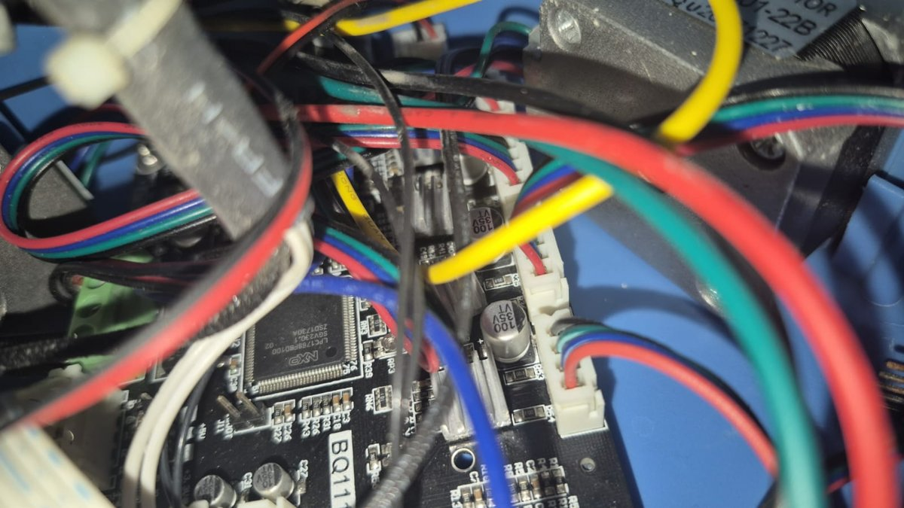
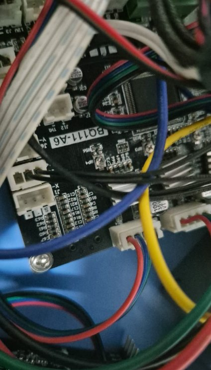


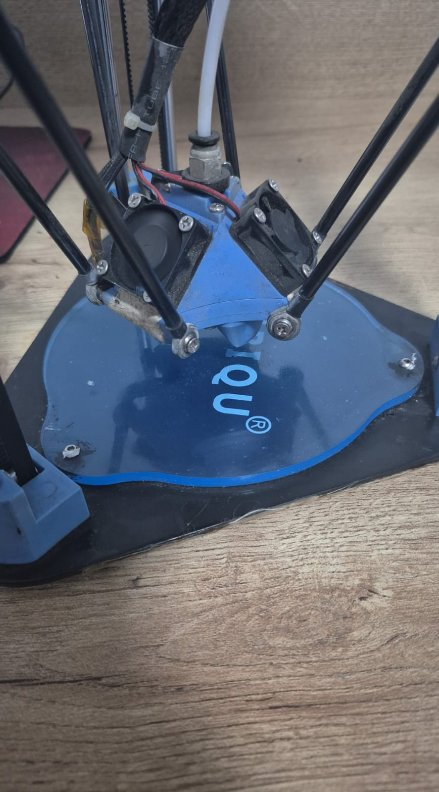

## Getting USB to work

1. **Driver.** On Windows the CP2102 shows up as "CP2102 USB to UART Bridge Controller" with an error until you install the **Silicon Labs CP210x** driver. Linux has it built in (`/dev/ttyUSB0`).
2. **Unplug the touchscreen's serial cable.** The screen and the USB chip share the mainboard's serial line. With the screen connected, you'll see `ok T:22.0 /0.0 @0` every 3 seconds (the board answering the screen's temperature polls), and **every command you send over USB is ignored**. With the printer off, unplug the cable from the screen board (the white connector next to the "5V" label, J3 on ours). After that, USB accepts commands normally. The screen stays dark, which is expected.
3. **Opening the port resets the board** (one of the CP2102's control lines drives reset). Homing is lost on every new connection, so keep one connection open for a whole session. [`tools/printer_link.py`](../tools/printer_link.py) does that.
4. **M115 returns only `ok`** on this Smoothie build. Use `version` to identify it.

## The SD card situation

- The slot on the side of the screen housing belongs to the **touchscreen board**, not the mainboard. On our unit the socket had **broken off** the screen board. That only affects printing from a card through the screen.
- **No SD card was found on the mainboard.** Smoothie runs on settings built into this firmware build (`M503` starts with `; No config override`), and **`M500` has nowhere to save**. Calibrated values have to go in the slicer's start G-code.

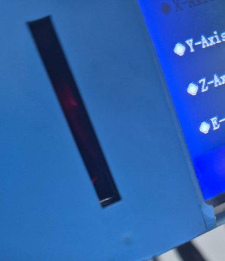


## Stock settings (from M503 on our unit)

```
M665 L146.03 R61.7     ; arm length, delta radius
M666 X0 Y0 Z0          ; endstop trims: all zero, never calibrated
M665 Z150              ; max height
M92 X100 Y100 Z100     ; steps/mm (checked with a tape measure: correct)
M92 E395               ; extruder steps/mm
M301 P22.2 I1.08 D114  ; hotend PID (holds 200 °C within about 1 °C)
```

Expect the max height to be well off: it can be more than 10 mm out, so approach the bed carefully the first time. After `G28`, Smoothie reports a Z about 4 mm below the max-height value, because the carriages back off the endstops.

## Calibrating without a probe

Marlin's `G33` doesn't exist in Smoothie. Smoothie's own `G32` needs a probe, and the Magician has none. A paper test over USB works well. Do it with the screen unplugged and the printer homed.

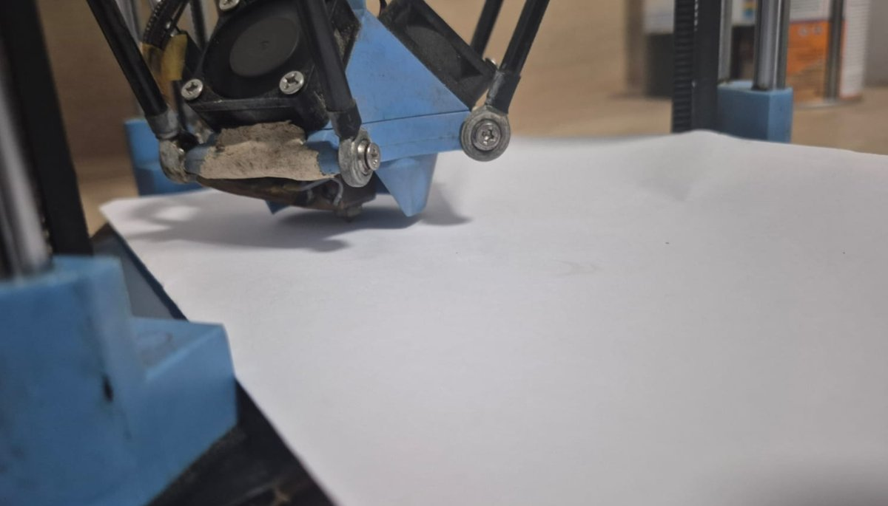

**Points.** Use the center plus the three towers at **30 mm** from center: front-left (X-26 Y-15), front-right (X26 Y-15), back (X0 Y30). Moves of 40 mm or more toward the back made our arms grind, but that was **before calibration**, with the height about 13 mm off. Once calibrated, a test run (nozzle 8 mm above the bed, no filament) reached 47 mm from the center and came within 23 mm of a tower with no noise at all. The 30 mm points are still a good choice for the paper test: they stay away from the pitted bed rim.

**Routine at each point.** Move sideways at a safe height, go down to about 2 mm above the expected bed, then step down 0.25 / 0.1 mm with a sheet of paper under the nozzle until light drag. Note Z and lift. Negative Z values are fine at this stage, since the height is fixed last.

**Order of corrections (Smoothie):**
1. **Tower trims (`M666 X Y Z`, X = front-left, Y = front-right, Z = back).** Smoothie expects trims ≤ 0. The tower where the bed is met soonest (highest Z reading) keeps 0, and the others get negative trims. Trims take effect at the next `G28`. **One mm of trim corrected only about 0.5 mm of difference** on ours, so scale the second round up. Three rounds got all towers within 0.05 mm.
2. **Delta radius (`M665 R`)**, only if the center differs from the towers once they agree. On ours the stock 61.7 was already fine.
3. **Max height (`M665 Z`).** Subtract the center's light-drag Z from the current value (for example, drag at Z -10.0 with Z150 gives Z160). Home again and check that light drag is at Z 0.

The touchscreen's Move menu (X/Y/Z, steps of 0.1 to 50 mm) works for jogging, but it shows no coordinates. You'd have to count presses, which is why the USB route is easier.

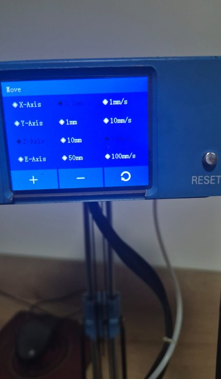

## Fans: important

On our unit **all three fans, including the heatsink fan above the nozzle, are on the switched fan output** (`M106`/`M107`). They do not come on by themselves when the hotend heats. The heatsink fan must run whenever the hotend is hot, or you risk jams and softened plastic parts. Until it's rewired to always-on 12 V or a separate output:

- start G-code begins with `M106 S255`, before any heating;
- slicer fan: 100% from the first layer, minimum 100%, no "fan off for the first layers" option;
- after a print, leave the fans on until the hotend is below 50 °C, then `M107`.

## Checking the extruder steps/mm

The stock `M92 E395` can be a few percent off. Test it hot, with filament loaded:

1. Mark the filament **50 mm** above the extruder's filament guide (a ruler and a marker are enough).
2. Extrude slowly: `M83`, then `G1 E40 F60` (40 mm at 1 mm/s).
3. Measure from the guide to the mark again. The extruder should have pulled in exactly 40 mm, so the mark should now be 10 mm above the guide.
4. New value = old value × 40 ÷ (50 − measured). On our unit the mark ended up 11 mm above the guide (39 mm fed), which gives 395 × 40 ÷ 39 ≈ **405**. A ruler is good to about ±1%, so a 100 mm feed gives a finer number.

Put the result in the start G-code (`M92 E...`), since `M500` can't save it.

## Start G-code template

Fill in your own calibrated values:

```
M106 S255                  ; fans on first (heatsink fan shares this output)
M665 L146.03 R61.7 Z<your max height>
M666 X<trim> Y<trim> Z<trim>
M92 E<your measured value>  ; extruder steps/mm (stock 395)
G28
```

Print from a computer over USB (OctoPrint, Pronterface, Cura) with the screen unplugged.

**Cura notes.** There's no Magician profile: add a *Custom FFF printer* with a 100 × 100 mm **elliptic** bed, **origin at center**, no heated bed, G-code flavor **Marlin** (Smoothie accepts it), and set the extruder's **material diameter to 1.75** (it defaults to 2.85). Cura puts its own `M107` (fans off) just before your end G-code, so start the end G-code with `M106 S255` to keep the heatsink fan running while the nozzle cools. Recent Cura versions also hide USB printing: tick **Preferences → General → Enable USB-cable printing** and restart Cura, otherwise you only get "Save to Disk". Keep Cura open until the nozzle has cooled, because disconnecting can reset the board and stop the fans.

**Without a host program**, `python tools/printer_link.py print COM3 file.gcode` streams a saved file line by line, then keeps the fans on until the nozzle is below 50 °C. Creating a file named `stop_print` next to the tool stops it cleanly (heater off, fans on, nozzle lifted). Creating a file named `fan_full` forces the fans to 100% at once and ignores later slicer commands that lower them, which makes it safe to try a lower fan speed. Add `--telemetry temps.csv` to log the hotend temperature, target and heater power while it prints.

Use PLA only: the bed is unheated. Painter's tape, glue stick on glass, or a self-adhesive PEI sheet all work. After adding a bed surface, lower `M665 Z` by its thickness and redo the center paper check.

**Cleaning the acrylic bed:** use warm water and dish soap. Avoid isopropyl alcohol and strong degreasers, which can cause fine cracks (crazing) in acrylic, especially around stressed spots like screw holes.

## First print

After the bearing replacement and the paper-test calibration, the first print was a **10 mm XYZ calibration cube** in gray PLA, on a thin layer of washable glue stick.

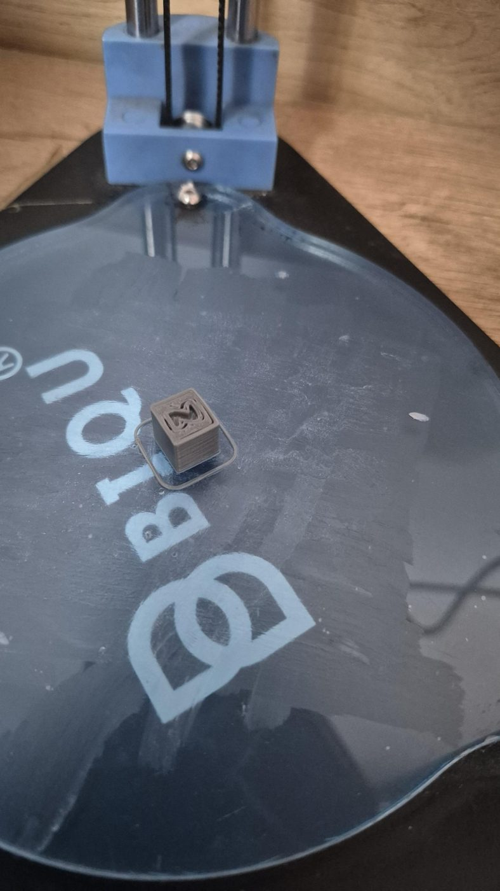

**Slicer settings that worked:**

| Setting | Value |
|---|---|
| Printer | Delta, round bed about 100 mm across, origin at the center |
| Nozzle / filament | 0.4 mm / 1.75 mm PLA |
| Layer height | 0.2 mm |
| Temperature | 210 °C (215 °C first layer) |
| Bed temperature | 0 (unheated, so the slicer doesn't wait for a bed) |
| Fan | 100% from the first layer |
| Retraction | 3–4 mm (bowden) |
| Adhesion | 2-loop skirt to prime the nozzle |

**Result:** it stuck well, the skirt came out as one even line, and the walls and the embossed X and Y letters are clean. All three axes measured the same, close to 10 mm, measured with a ruler and photos (calipers will give a finer number). Only the top "Z" is messy. That's typical of a 10 mm cube, where each top layer takes a few seconds and doesn't cool before the next. Setting a **minimum layer time of about 10 seconds** in the slicer helps with small parts.


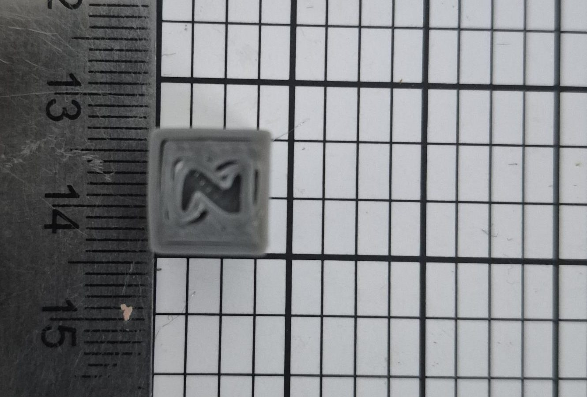
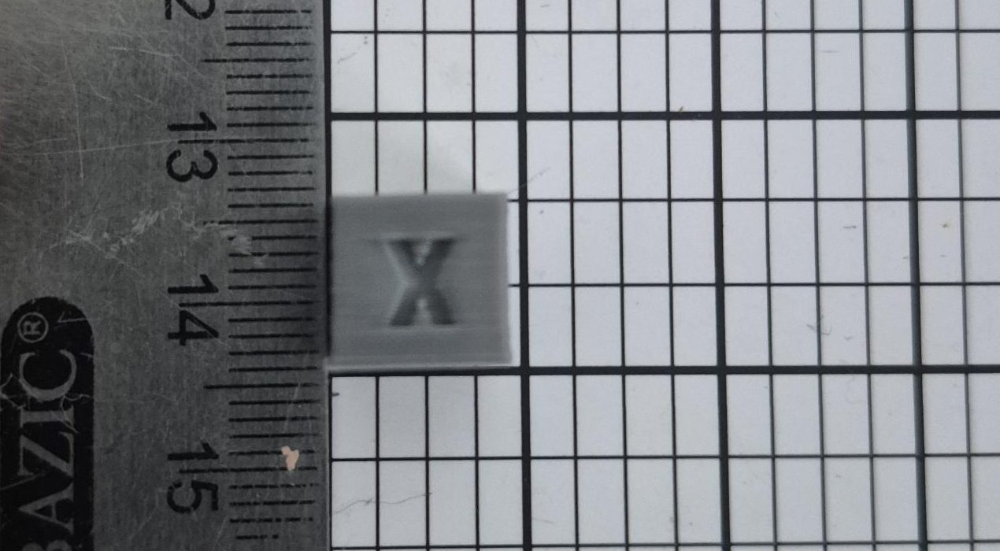

> **Don't print downloaded G-code.** G-code only works on the printer it was sliced for. Files made for other printers (for example a Prusa MK3S) move far outside the Magician's ±50 mm reach from the bed center, wait for a heated bed it doesn't have, and use fan settings that are unsafe here. Always slice the model file (STL) with your own settings.

## Second print: a small figure with supports

A 40 mm figure (a "cute triceratops" model scaled to 40 mm long) printed fine in PLA over USB from Cura on glue stick, about 40 minutes including supports. Settings used, on top of the cube settings above:

| Setting | Value |
|---|---|
| Layer height | 0.16 mm (first layer 0.3 mm) |
| Temperature | 200 °C |
| Speed | 30 mm/s, first layer 15 mm/s (Cura slows the walls down by itself) |
| Supports | **Tree**, placement **touching build plate**, overhang angle 50°, tip diameter 0.8 mm |
| Fan | 100% from the first layer |
| Infill | 15% |

Tips for small models:
- **Check the real overhangs before slicing.** Cura's "3D Model Assistant" support warning is generic. For this figure the belly between the legs needed supports (the chin and frill did not), so tree supports touching only the bed were enough and snapped off easily.
- **Details thinner than about 1 mm print as blobs** with a 0.4 mm nozzle. We printed the "smooth back" version of the model because the version with tiny back plates would have turned to strings at 40 mm.
- **Check the size first.** The reach is about ±50 mm from the center and about 150 mm of height, so parts made for bigger printers often don't fit. A spool-holder base made "for the Magician" turned out to be 120 × 108 mm and 160 mm tall: it bolts onto the printer but can't be printed on it.
- **Dry-run big parts first.** For a part that reaches near the edge (ours was a 76 × 49 mm plate), read the reach off the sliced G-code (the closest the nozzle gets to each tower, and the farthest point from the center), then trace the outline with the nozzle 8 mm above the bed and no filament, in three passes at 60%, 80% and 100% of the way out, listening for grinding. Rotating the part so its long side runs between two towers, and a 1 mm skirt instead of 3 mm, both gave a few extra millimetres of margin.
- **Keep prints near the center** until the bed has a flat surface: the edges of our acrylic are pitted.

## Glass bed

- **The surface:** a **120 mm round glass plate** laid on top of the acrylic bed. Glass is flatter than acrylic, can be cleaned with alcohol (unlike the acrylic), and releases PLA once it cools. It still needs a thin layer of glue stick for adhesion, since the bed is unheated.
- **Clean underneath first:** wipe the acrylic and the bottom of the glass. Glue residue or dust trapped between them makes the glass rock or sit unevenly, and that shows up as an uneven first layer.
- **Hold it down:** use 2–3 small binder clips or printed clips at the edge. Keep them outside the reachable print area, so the nozzle and probe can't hit them.
- **Recalibrate afterward:** the glass raises the bed by its thickness (usually 2–3 mm). On Klipper, redo `PROBE_CALIBRATE` and `DELTA_CALIBRATE` with the glass in place. On stock firmware, lower `M665 Z` by the glass thickness, then redo the paper test.
- **Size vs reach:** the glass is wider than the area the nozzle can reach (about 100–110 mm across), so the outer edge just gives the clips somewhere to go.

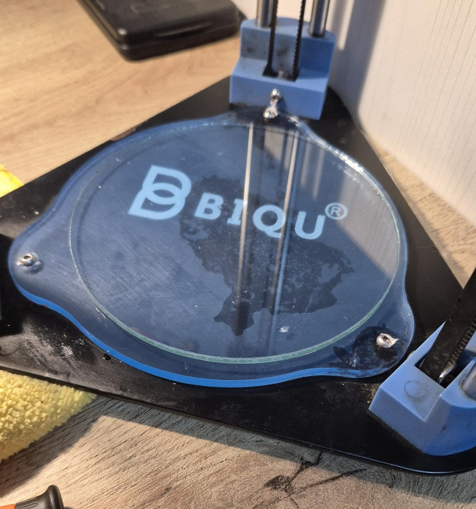

### Bed stack measurements

Ruler readings from photos (±0.5 mm). Confirm them with calipers.

| Layer | Thickness |
|---|---|
| Steel base plate | about 2 mm |
| Acrylic bed (3 screws at its lobes) | about 3 mm |
| Glass plate | about 2 mm |
| Glass diameter | about 120 mm |

The glass raised the bed by about 2 mm, so the Z height Klipper saved on the bare acrylic is about 2 mm too low for the glass. **Redo the Z height (and ideally `DELTA_CALIBRATE`) with the glass clamped in place before printing.**

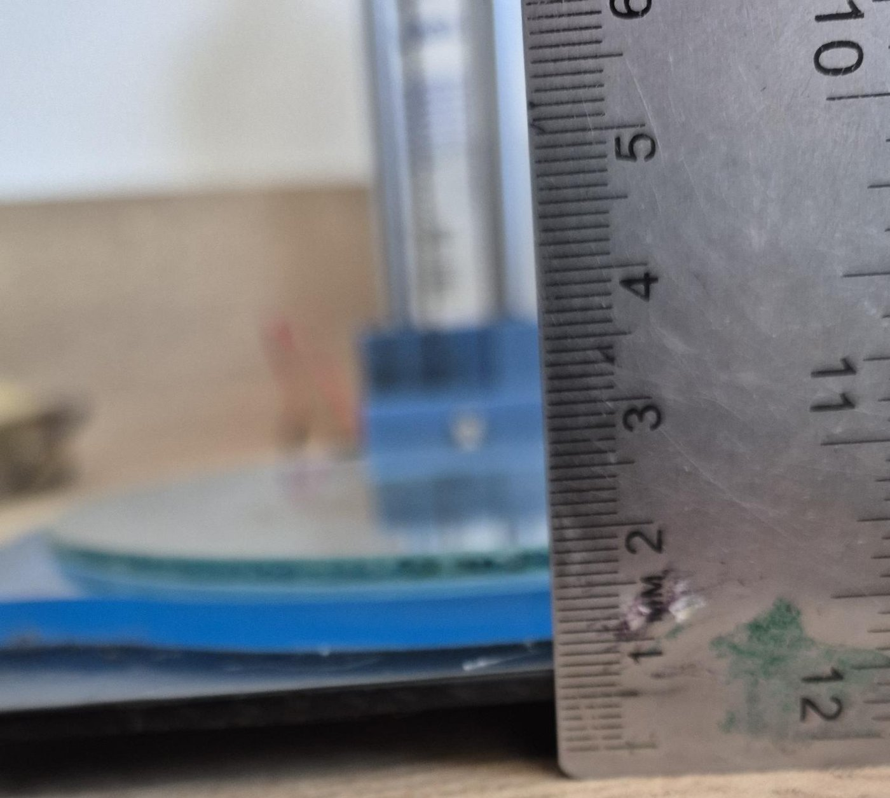
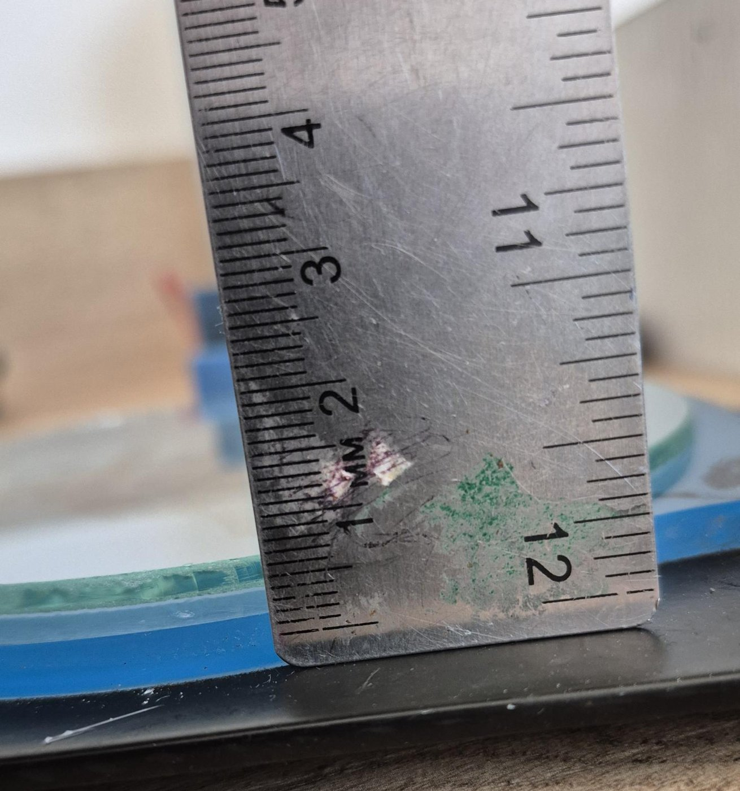
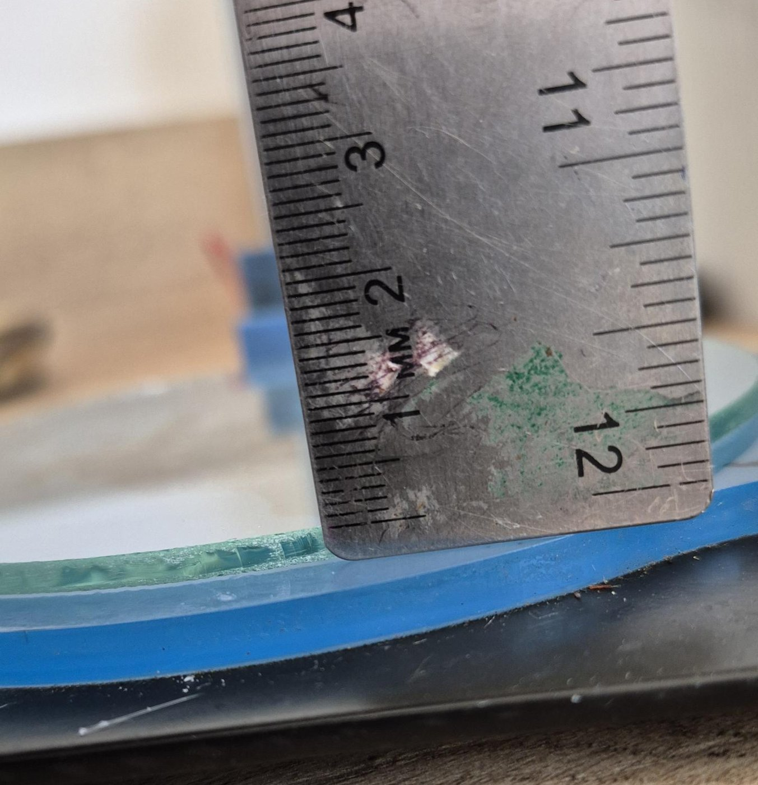
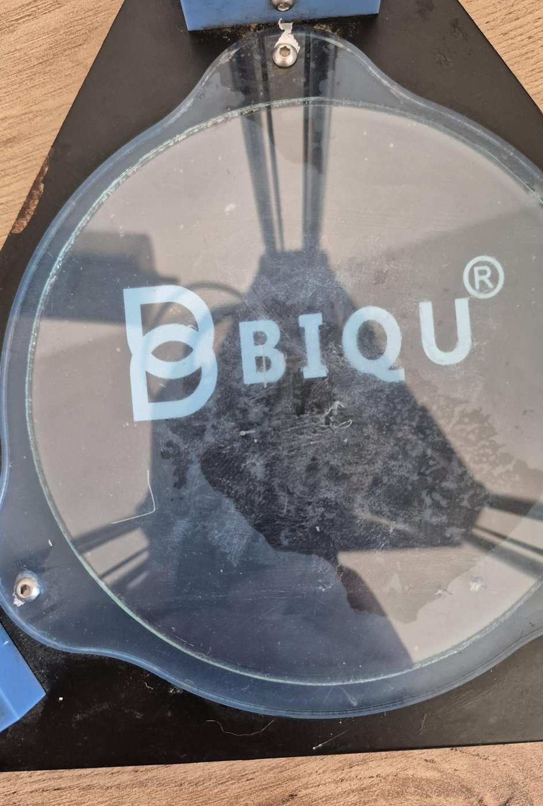
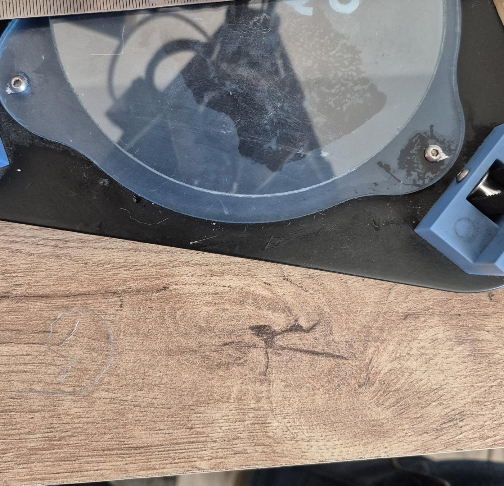

### Plan: glass straight on the steel plate, held by printed clamps

1. **Clamps:** use printed tabs under the **three existing bed screws**, each with a lip that overhangs the glass edge by 2–3 mm. The lip height has to match the glass thickness (about 2 mm). A ready-made design for this printer is the [Biqu Magician Mirror Clamp](https://www.thingiverse.com/thing:3128172). Check its lip height against your glass, and model a custom one if it doesn't match. Keep the clamps low and outside the nozzle's reach (beyond about 50–55 mm from the center), so the probe roller and arms never hit them. Quick alternatives: 15–19 mm binder clips with the handles folded down, or a thin water film under the glass.
2. **Optionally remove the acrylic** and put the glass directly on the steel plate. That gains only about 3 mm of height; the real benefit is flatness, since acrylic is soft, can bow, and is chipped at the screw holes.
   - **First, straightedge test:** stand a steel ruler on its edge across the bare plate in several directions. If light shows under it, the plate is bowed: keep the acrylic, or put a thin cork or silicone sheet under the glass.
   - **Rust:** scrub only the rust spots with #000 steel wool (dry, or with a drop of oil, then degrease with isopropyl alcohol, which is fine on steel). Don't strip the black coating broadly. Remove **every** steel-wool fiber, using a magnet to help: a single fiber under the glass makes it rock, and the fibers are conductive. Seal bare spots with a dab of black paint or clear lacquer, and let it dry fully.
   - **Screws:** check that the three screw holes in the plate are threaded, and fit shorter screws if the old ones now stick out too far underneath.
   - **Clamp measurements so far** (rough, from ruler photos): the bed screws look like **M3 button-head hex screws**, and the **screw center sits about 15 mm (up to about 20 mm) from the glass edge**. Clamp design to match: a flat tab about 25–30 mm long and 10–12 mm wide, a **slotted M3 hole** so each clamp can slide in or out (the glass may not be perfectly centered), and a lip that steps down by the glass thickness and reaches about 3 mm over the edge. Keep it 2–3 mm tall overall so the probe and arms clear it. **Still to measure at each of the three screws:** screw center to glass edge, screw head diameter, and the exact glass thickness (calipers).

     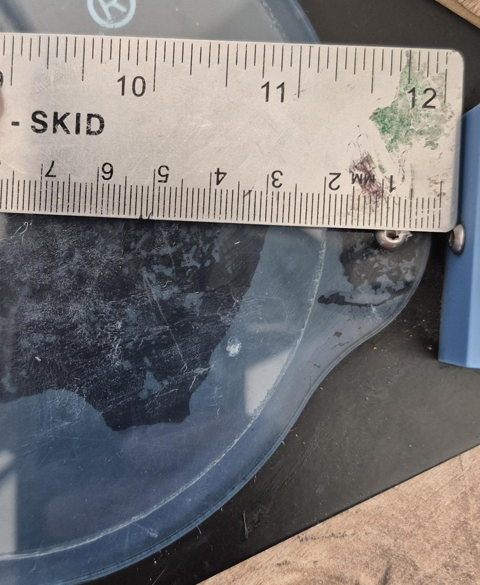
     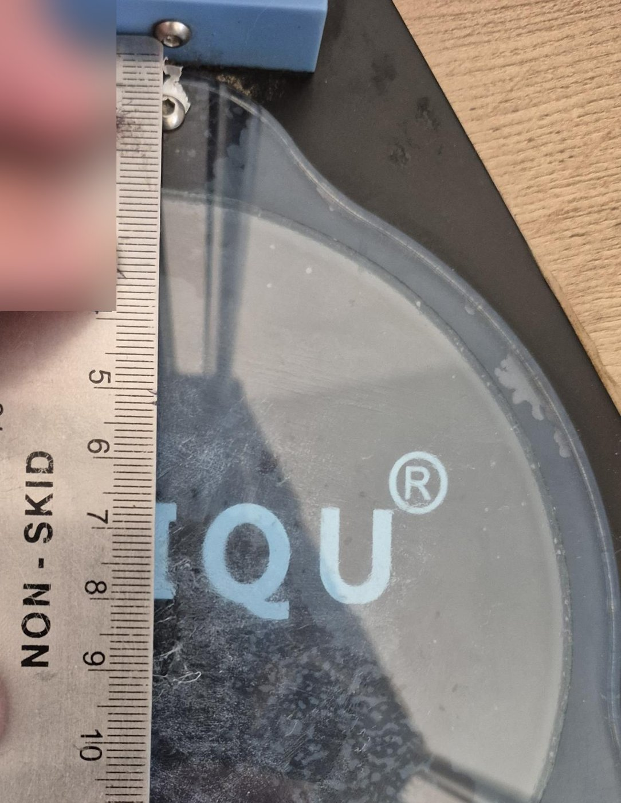
   - **First clamp test print:** the arm printed cleanly, but **the lip end came out messy and stringy**. Likely causes and fixes:
     - **The lip was printed over air.** If the face that presses on the glass hangs unsupported, those layers droop into strings. **Flip the part so the glass-contact face sits on the bed** (upside down), or print it on its side if the slicer shows no overhang that way.
     - **The lip is tiny, so each layer finishes in seconds** and has no time to cool: the same effect as the cube's messy "Z" top. Set **Minimum Layer Time to about 10 s** in Cura, **print all three clamps at once** spaced apart so each layer takes longer, and slow the outer walls to about 20 mm/s.
     - **Before printing the set,** test-fit this piece: the lip step should press the glass down lightly (no gap, no forcing), the slot should line up with the screw, and the lip should reach about 3 mm over the glass edge.

     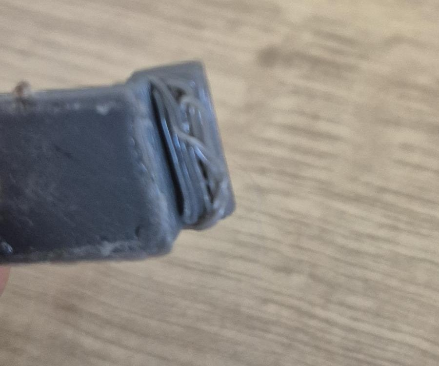
     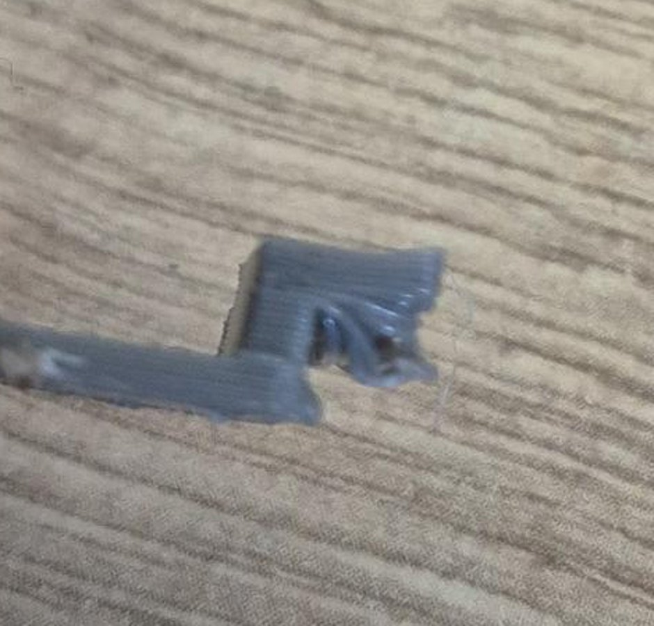
   - **Clamps installed:** three printed clamps under the original bed screws, with the slotted holes taking up the small differences between screws, and the lips flat over the glass edge. The glass was cleaned underneath (the dark patch is gone) and stays on the acrylic for now. Checks before calibrating: no rocking when pressed at the center or near each clamp, screws snug but not cranked down (the acrylic is chipped at the holes), and a slow pass at Z 20 toward each clamp to confirm the probe roller and arm joints clear them.

     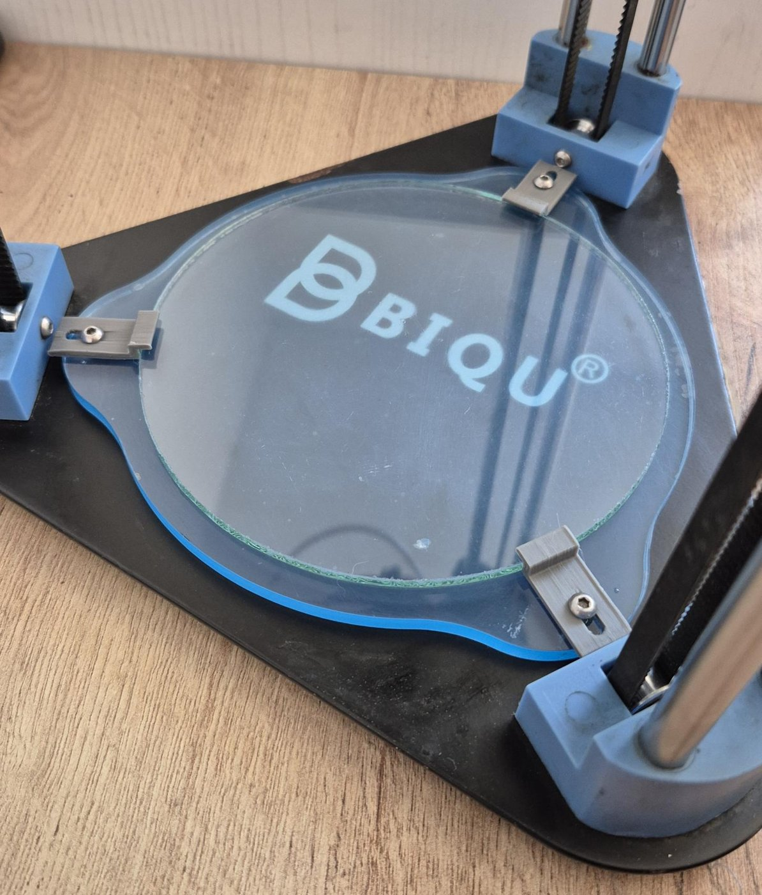
     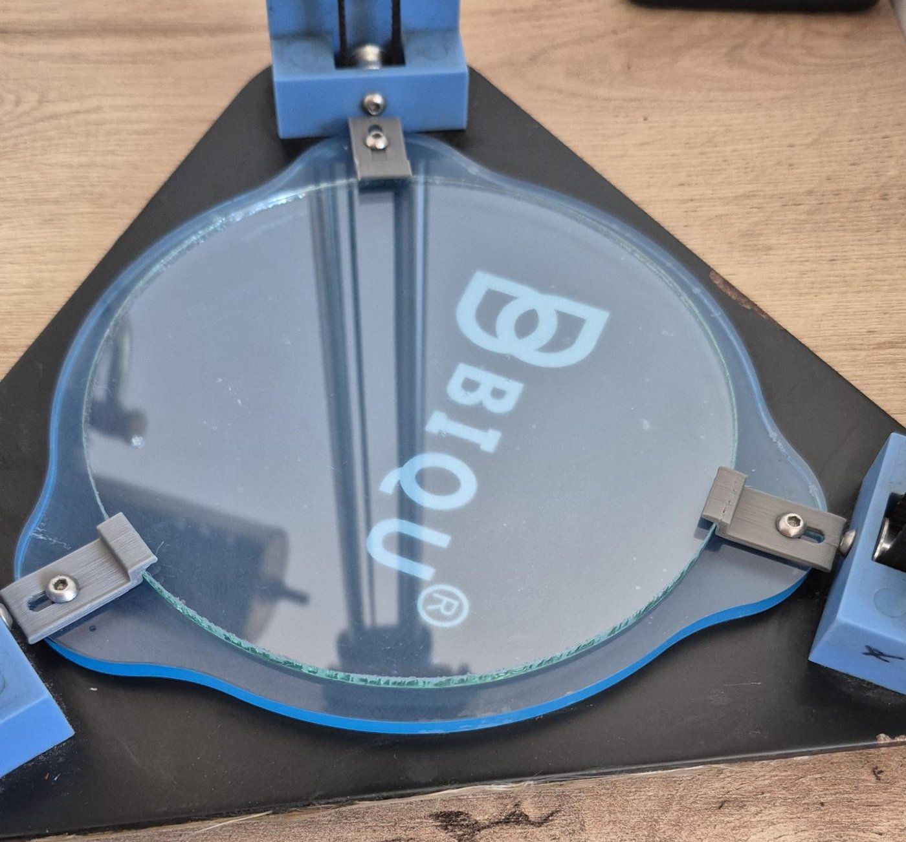
3. **Recalibrate** after any change to the bed: the Z height, then `DELTA_CALIBRATE` (and optionally a bed mesh). The carriages have plenty of spare rod below to go a few mm lower.

## Adding a probe

The firmware's probe module is enabled (`M119` shows `Probe: 0`), and **the probe wiring is already there**: a loose **2-pin plug next to the nozzle block** (about 3.3 V across its pins with the printer on). Bridging its two pins flips `M119` to `Probe: 1`. Only the switch itself is missing.

- The firmware reads the probe on **P1.28, inverted with pull-up** (`1.28!^`), so it expects a switch that is **open at rest and closes when pressed**. Wire a lever microswitch's **C and NO** terminals to the plug, **not NC**, or the probe reads "triggered" all the time. The setting can't be changed without an SD card.
- A probe that sits below the nozzle would drag across prints, so make it **removable** (clip or magnet on the nozzle block) and take it off before printing.
- The stock leveling mode is **three-point leveling**: `G32` probes three points and compensates for bed tilt; it does **not** calculate tower trims or delta radius. `G30` (a single probe) works for checking heights at the towers.
- **Inductive sensors won't work** on the acrylic bed, and **BLTouch needs config changes**, which need an SD card.

**Reading the stock config without an SD card:** Smoothie's `config-get <setting>` answers over USB with the value built into the firmware (for example `config-get zprobe.probe_pin`, `config-get alpha_step_pin`). It prints a `cached:` line and no `ok`. On our unit: steppers step P2.0–P2.3, endstops P1.25/P1.27/P1.29 (max, homing up), heater P2.7, thermistor P0.24 (EPCOS 100K), fan P2.4, probe P1.28. That's the pin map a Klipper config needs.

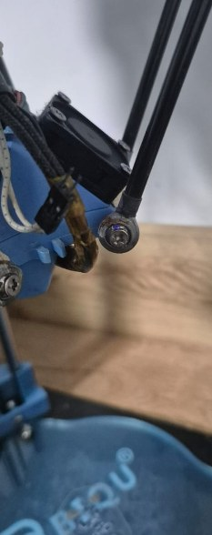

**How we confirmed the plug:** with the printer on, a multimeter showed 3.3 V across its two pins, which is the pulled-up signal against ground, so shorting them is safe. While watching `M119` (it only reads, nothing moves), touching a paper clip across the two pins flipped `Probe: 0` to `Probe: 1`. Don't short anything on a connector with three or more pins until you know which pin is 5 V.

**Planned switch:** a subminiature **lever microswitch with three terminals (C, NO, NC)**, such as Steren's SS0505A. Wire **C and NO** to the plug (a plain switch has no polarity). Under Klipper, **C and NC** is the safer choice: use `pin: ^P1.28` (no `!`), and a broken wire then reads as "triggered" instead of letting the nozzle crash. On a delta, the probe has to be removable, or retract above the nozzle, so it doesn't drag on prints. Its X/Y/Z offset from the nozzle can be set with `M565` in the start G-code.

**Temporary mount (fitted):**
- An SS0505A roller-lever switch, wired **brown = C (GND)** and **red = NC (signal)**.
- Zip-tied flat against the underside of the nozzle block.
- The roller hangs about **1.5 cm below the nozzle tip**. That's a rough reading from a tape measure, and it's fine for calibration because `PROBE_CALIBRATE` measures the real `z_offset`. It **must be removed or raised before printing**.
- The roller sits roughly **2–3 cm to one side** of the nozzle. Measure the exact X/Y offset for `[probe]`.
- In Klipper, because it's NC: `pin: ^P1.28` (pull-up, **not** inverted), so a broken wire reads as triggered. Verified: `QUERY_PROBE` says open at rest and TRIGGERED when the roller is pressed. (`^!P1.28` is for a C+NO switch.)
- **Clean the old plastic blob off the nozzle** before calibrating.

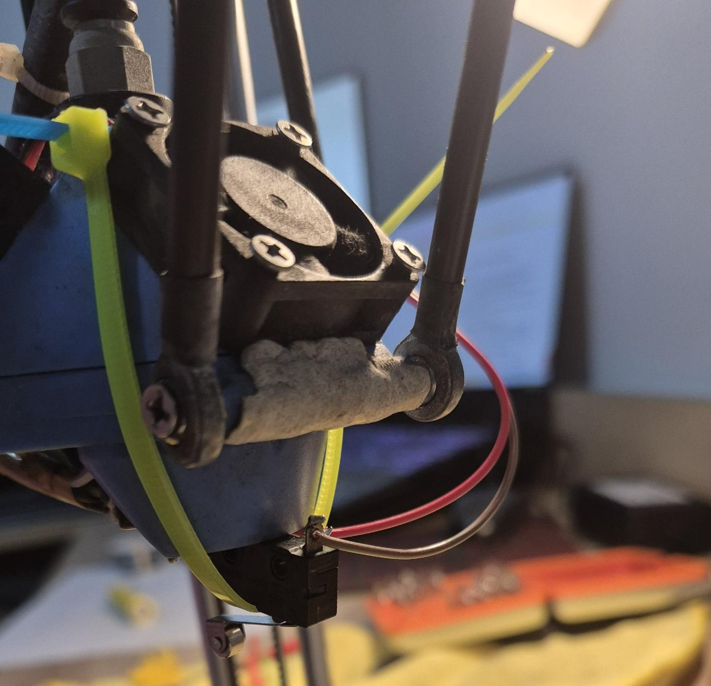
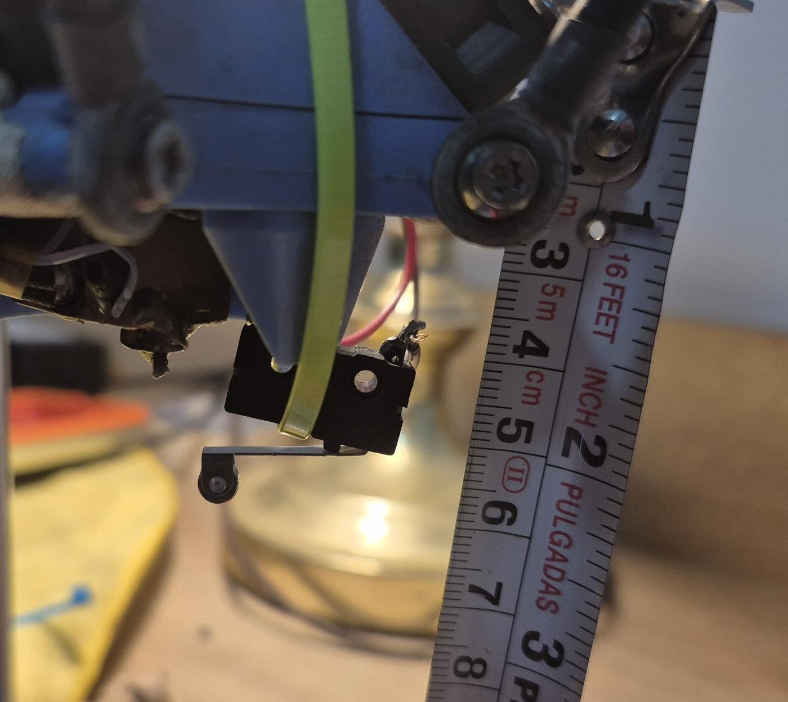

**Second measurement:** a ruler held level against the bottom of the roller puts the roller roughly **1.3 cm below the nozzle tip** and about **1 cm sideways** from it. These are photo estimates, so treat them as starting values: Klipper's `PROBE_CALIBRATE` measures the real `z_offset`, and `x_offset`/`y_offset` should be checked against a test print or a marked dot on the bed. In the front view, the roller hangs straight down under the switch, and the zip tie stays clear of the lever.

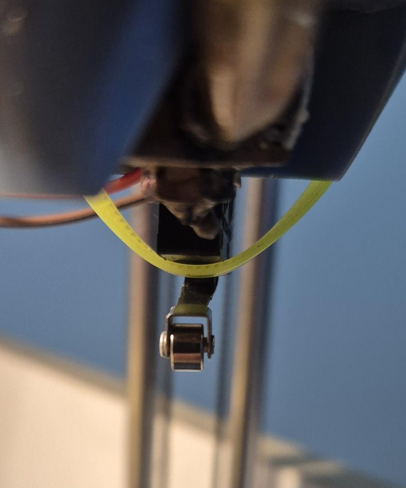
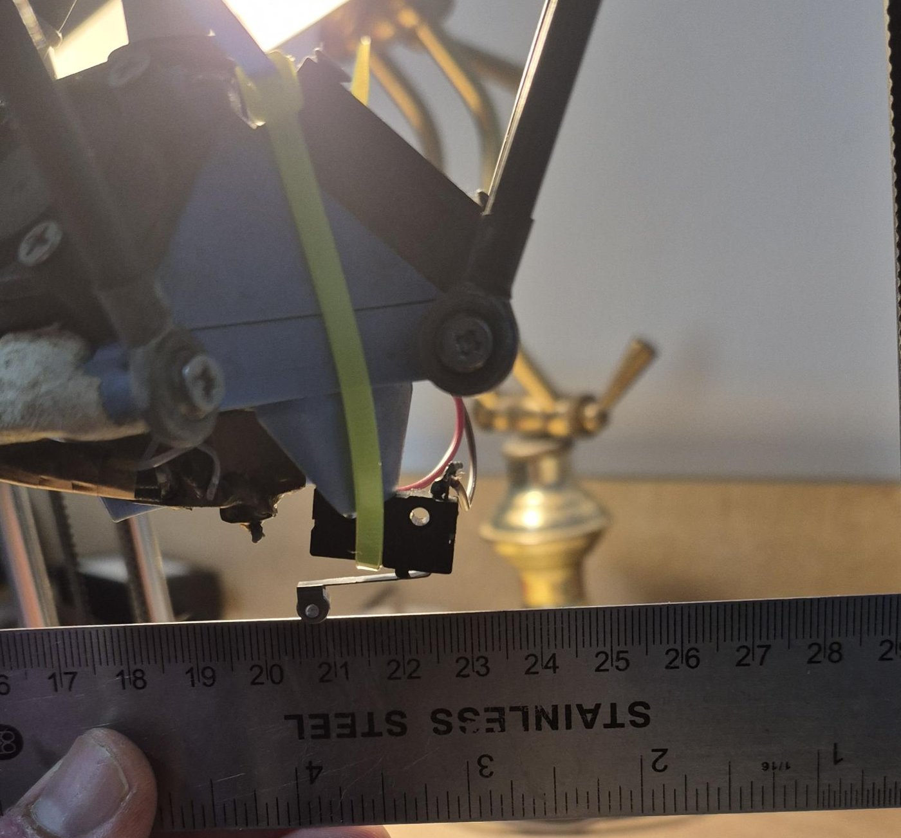
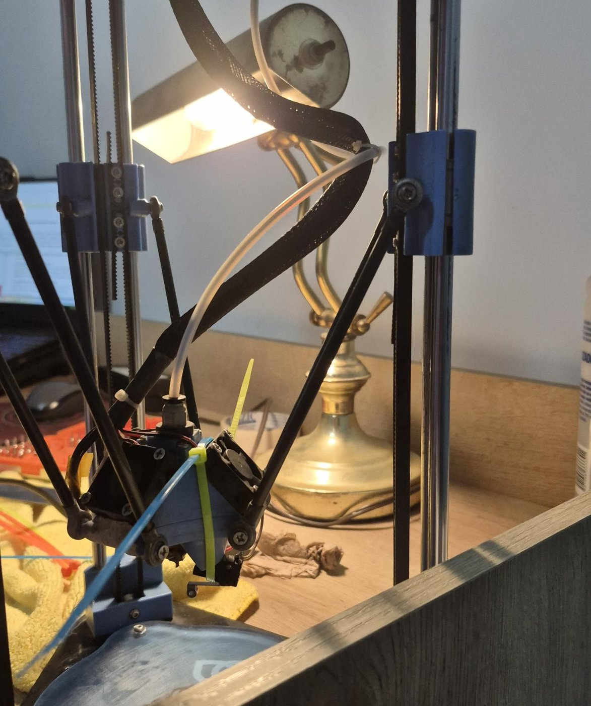

### Probe remounted closer to the nozzle

The switch was moved up next to the nozzle block. Rough ruler-photo estimates:
- Roller contact point about **9–10 mm below the nozzle tip** (was about 13–15 mm).
- About **20 mm sideways** from the nozzle.

Photos can't give Klipper's X/Y offsets reliably: perspective distorts them, and they don't show which way the probe points relative to the printer's axes. **Measure them on the printer:**

1. Put a strip of masking tape on the glass near the center and mark a small dot.
2. `G28`, move down to about Z 1, and jog until the **nozzle tip is exactly over the dot**. Note **X1, Y1** (Mainsail or `GET_POSITION`).
3. Raise to about Z 15, then jog until the **roller's contact point is over the dot**, lowering slowly until it just touches. Note **X2, Y2**.
4. **`x_offset = X1 − X2`**, **`y_offset = Y1 − Y2`**. Example: nozzle over the dot at (0, 0) and roller over it at (0, 20) gives `x_offset: 0`, `y_offset: -20`.
5. Put the values in `[probe]` and restart Klipper.
6. **Z offset:** `PROBE_CALIBRATE` with the glass clamped in, paper test at the end (`TESTZ` until light drag, then `ACCEPT`), and `SAVE_CONFIG`.
7. Keep **`horizontal_move_z` at 15 or more**, so the hanging roller clears the glass and the clamps between probe points. Then run `DELTA_CALIBRATE` and reprint the 10 mm cube.

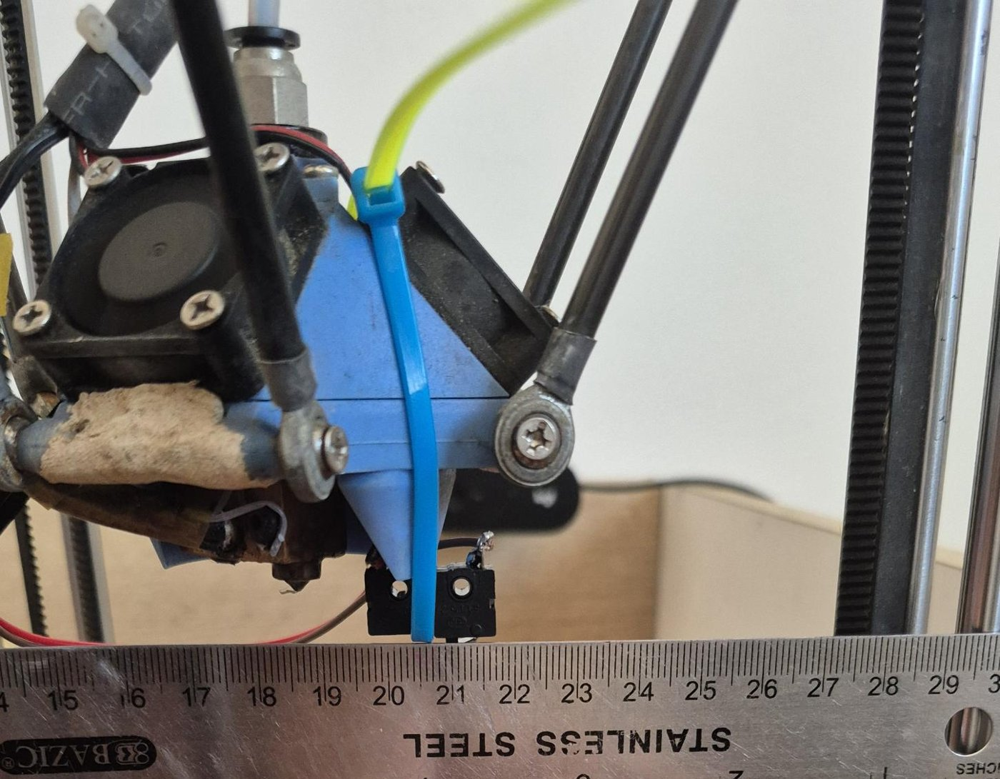
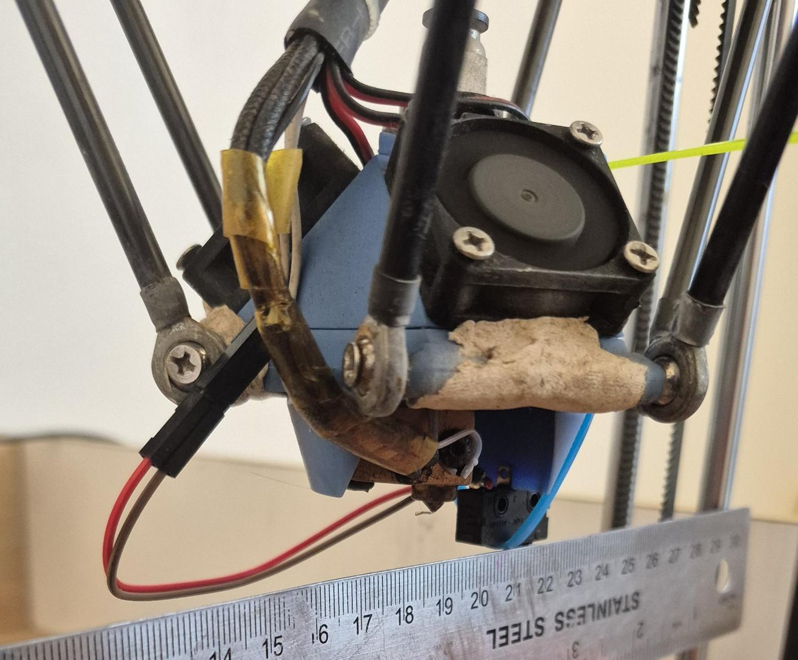
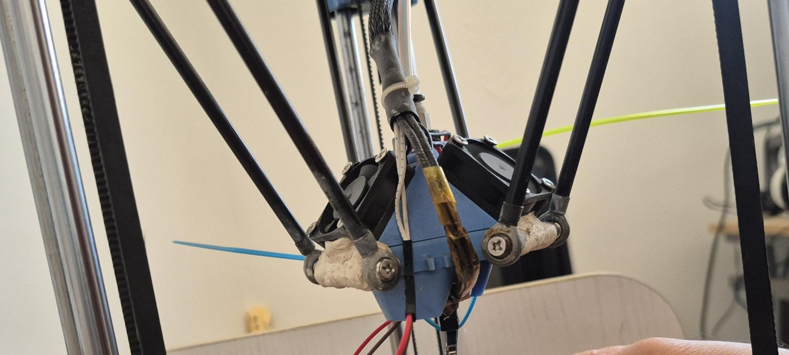
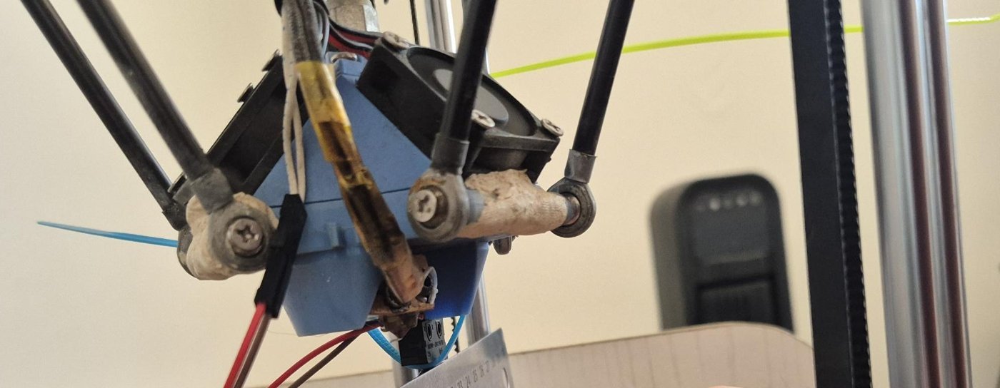

**Next: a proper bracket.** A removable clip-on bracket that slides onto the molded teeth on the effector (or goes under a fan screw), with slotted M2 holes to set the roller 3–5 mm below the nozzle: [models/probe-mount](../models/probe-mount/).

**Before moving the printer: trim the zip-tie tails.** Long tails sticking out of the nozzle block can catch the arms, belts or rods as the head moves.

## Klipper?

The LPC1768 is supported by Klipper. Without a mainboard SD card, flashing goes through the chip's built-in serial bootloader (ISP) or its SWD debug port. A Linux host is needed, and the stock touchscreen no longer works afterward.

### Board details for flashing (BQ111-A6)

| Part | What it is | Status |
|---|---|---|
| **J11 "BOOT"** (2-pin, next to the LPC) | The **ISP jumper**. Bridged at power-up, the LPC starts its ROM bootloader on UART0, which is reached through the CP2102 USB port. | **Confirmed**: with it bridged, the board answered `lpc21isp` and a full flash read worked. |
| **J19** (3-pin, between "+3.3V" and "+5V" labels, next to AUX-1) | A voltage selector by AUX-1 (J14: 5V / GND / TX / RX, the touchscreen serial port). | **The USB serial port disappears when its cap is removed.** The factory position wasn't recorded. Test the middle pin + **+3.3V side** (toward the AMS1117 regulator) first, then middle + +5V if the port doesn't appear. **Record the working position here.** |
| **Crystal** (small silver SMD part near the LPC) | Marked **12.000 MHz** (the first digit is faint). | Consistent with stock Smoothie and the 115200 baud working. Klipper's LPC176x build needs 12 MHz. |
| **Debug header** (labels RST, TCK, TMS, pin 1 marked) | **JTAG/SWD**: TMS = SWDIO, TCK = SWCLK, RST = reset. The other pins are probably GND and 3.3V. | Found, not yet used. A Raspberry Pi Pico running "debugprobe" firmware plus OpenOCD (`interface/cmsis-dap.cfg`, `target/lpc17xx.cfg`) can read and write the whole flash. **Share GND only; don't power the board from the Pico.** |
| **"− E0 +"** green terminal | Hotend heater output (MOSFET-switched). | The heater cartridge has no polarity. The **power input** terminal does, so don't mix them up. |

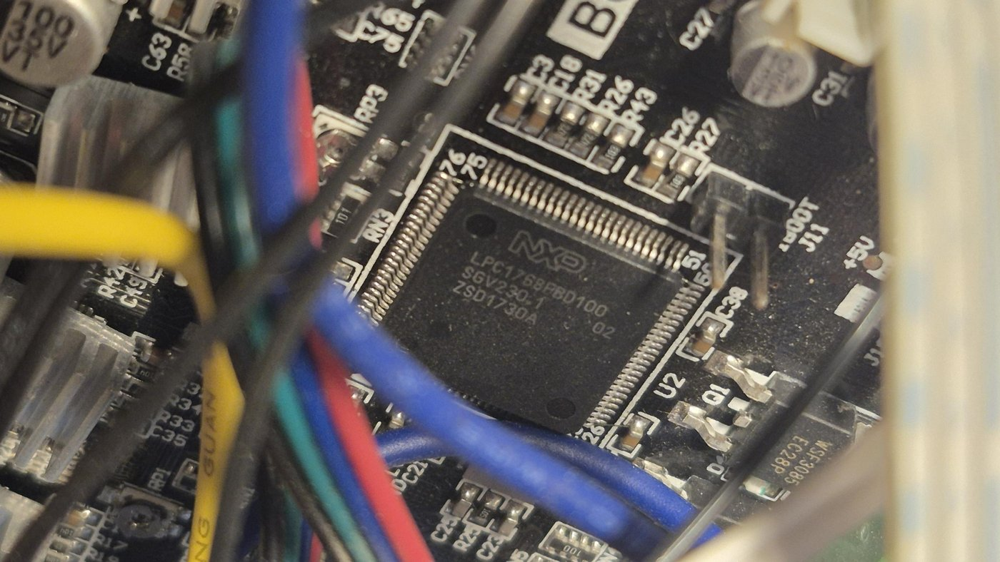
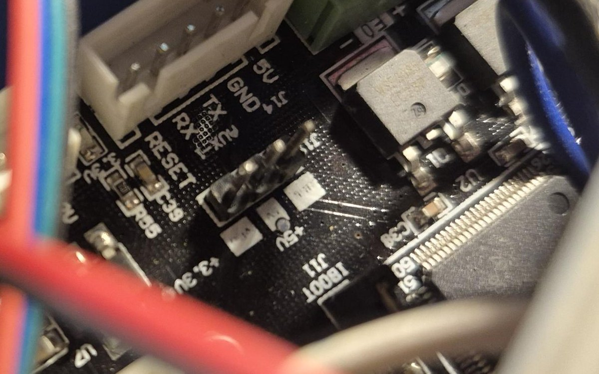
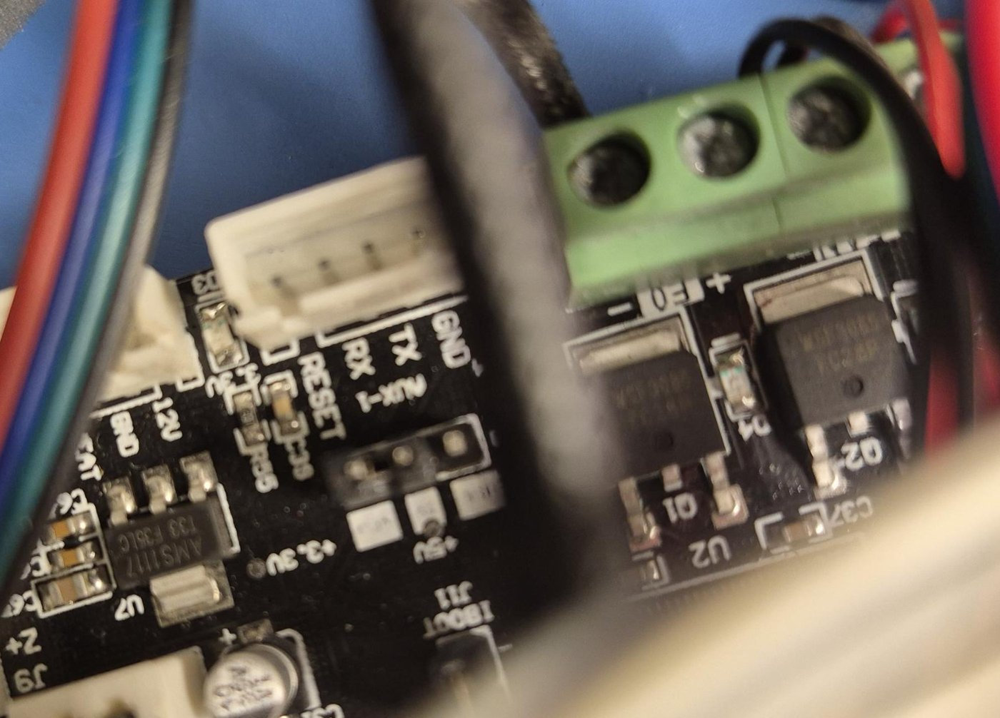
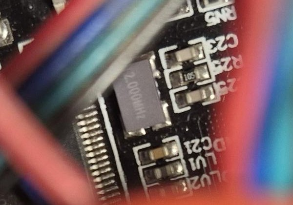
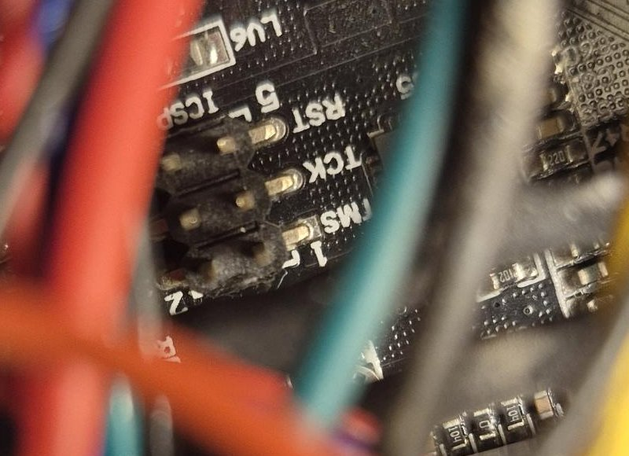

### Stock firmware backup over ISP

- A full 512 KB read over ISP, done twice with identical results, showed that **Code Read Protection is off**.
- From **0x4000** on, the image is the complete Smoothie firmware: stack pointer 0x10008000, valid vectors, ending around 382 KB.
- **The first 512 bytes (0x000–0x1FF) cannot be read over ISP.** They read back the same before and after flashing Klipper: the boot ROM covers them (the first words are its own vectors, `10001ffc 1fff0081`). `lpc21isp -verify` therefore always reports a compare error on sector 0, even though the write is fine (read back and compared from 0x200 on).
- Everything else in 0x200–0x3FFF is real: a small bootloader of about 14 KB, then 0xFF padding. The vector table at 0x0 was **not** captured, so its words must be rebuilt: the stack pointer is probably 0x10008000 (top of RAM), the reset vector points into the bootloader, and the checksum word at 0x1C is computed from the other vectors. An **SWD read** gives an exact copy.
- **Restore plan:** write the backup back with the first 512 bytes rebuilt (see [Klipper on the Magician](klipper.md#restoring-the-stock-firmware)), or flash an exact SWD dump.
- Either way the board is hard to brick. The ISP bootloader is in ROM, and the BOOT jumper and SWD header always allow reflashing.

### Klipper build settings

- `make menuconfig`: **LPC176x**, **LPC1768 (100 MHz)**, bootloader offset **No bootloader**, communication **Serial on UART0 (P0.3/P0.2)** at **250000** baud.
- **Heater warning:** with BOOT bridged and power on, nothing controls the heater pin and it **heats by itself** (we saw 27 → 115 °C in about a minute). Unscrew one heater wire first.
- Flash it with BOOT bridged: `lpc21isp -bin -verify out/klipper.bin /dev/ttyUSB0 115200 12000`. Then remove the jumper and power-cycle. Full steps: [Klipper on the Magician](klipper.md).
- Pin map from `config-get` (see [Adding a probe](#adding-a-probe)): steppers step P2.0–P2.3, endstops P1.25/P1.27/P1.29 (max), heater P2.7, thermistor P0.24, fan P2.4 (the heatsink fan is on this output, so in Klipper it must be a `[heater_fan]`), probe P1.28.

## Tool

[`tools/printer_link.py`](../tools/printer_link.py) keeps one serial connection open and lets you send G-code from short commands. It ignores the touchscreen's temperature chatter and reopens the port if the printer is power-cycled. Run it with Python 3 and `pyserial`; see the docstring for usage.
