# 10 mm XYZ calibration cube: the reference print

The same small cube is printed on each firmware or hardware change, so results can be compared like for like: first on the stock Smoothieware firmware, later on Klipper. Everything needed to repeat it is below.

## The file

The STL is **not included here**: it is a third-party download and we could not confirm its author or license (the pages we tried to read refused automated access). Fetch it yourself and check that it matches:

| | |
|---|---|
| File name | `xyz-10mm-calibration-cube.stl` |
| Size | 6,884 bytes, binary STL, 136 triangles |
| SHA-256 | `812e9f3b896ad2331693c232fa4fbbf234231ff06ca133e15247e3cadcad849f` |
| Bounding box | 10.0 × 10.0 × 10.0 mm (the model's origin is not at its center; the slicer recenters it) |
| Faces | X, Y and Z embossed on three faces |

It was probably downloaded from one of the Printables "XYZ-10mm Calibration Cube" models ([32539](https://www.printables.com/model/32539-xyz-10mm-calibration-cube) or [279946](https://www.printables.com/model/279946-xyz-10mm-calibration-cube)), but that is unverified. Any 10 mm cube works for a rough comparison; for a strict one, match the hash. If you confirm the license is CC BY or CC0, add the file here with its attribution.

Do not reuse G-code from another printer: slice the STL with your own settings (see the warning in [Reviving a BIQU Magician](../../docs/reviving-the-magician.md#first-print)).

## Settings used (stock Smoothieware, Cura 5.14)

| Setting | Value |
|---|---|
| Printer | Custom FFF, 100 mm round bed, origin at center, G-code flavor Marlin |
| Layer height | 0.2 mm (first layer 0.3 mm) |
| Temperature | 200 °C, bed unheated |
| Speed | 30 mm/s, first layer and walls 15 mm/s |
| Fan | 100% from the first layer |
| Adhesion | skirt, 2 loops |
| Infill | 20% |
| Retraction | Cura default (6.5 mm) |
| Surface | one thin coat of glue stick on the bare acrylic bed |
| Material | grey PLA, 1.75 mm |

The print takes about 7 minutes and uses about 1 g of filament.

## Results

Both cubes from the same STL and slicer profile, in the same grey PLA. **Left: stock Smoothieware. Right: Klipper v0.14.0** (after `DELTA_CALIBRATE` with the temporary probe and a paper-test Z height, see [Klipper on the BIQU Magician](../../docs/klipper.md)).

| | Stock Smoothieware | Klipper |
|---|---|---|
| X × Y × Z measured | about 10 mm on each face (ruler and photos, ±0.3 mm) | looks the same size by eye; not measured yet |
| Top face (Z) | messy: the embossed Z is blobbed and the top lines are rough | **clearly better**: clean Z, even top lines |
| Letters X and Y | crisp | slightly crisper edges |
| Bottom edge | square | **elephant's foot**: the bottom layers flare out, with a small blob at one corner of the Y face |
| Side walls | smooth, even layers | a little more textured: possibly slight over-extrusion or no pressure advance yet |
| Calipers (X, Y, Z) | not measured yet | not measured yet |

**What this says:**
- **Klipper's motion is better.** The top surface improvement is the clearest difference: smoother moves and steadier extrusion where the nozzle changes direction a lot.
- **The first layer is too close on Klipper.** The elephant's foot means the nozzle starts a little low, so the first layers are squished out. The Z height came from a paper test with the probe removed, which is easy to get slightly low.
- **The extrusion isn't tuned yet** on Klipper (no extruder calibration or pressure advance), which fits the textured walls.

**Next tuning steps on Klipper:**
1. **First layer:** raise the nozzle 0.05–0.1 mm. On the next print, baby-step Z up in Mainsail during the first layer until the lines are flat but not squished. Then save it (`Z_OFFSET_APPLY_ENDSTOP` for endstop-based Z, or `Z_OFFSET_APPLY_PROBE` when probing, then `SAVE_CONFIG`). In Cura, "Initial Layer Horizontal Expansion" at −0.1 to −0.2 mm also hides a small elephant's foot.
2. **Extruder:** mark the filament 120 mm above the extruder, extrude 100 mm slowly with the hotend hot, measure what's left, and correct `rotation_distance` for the extruder.
3. **Pressure advance:** run Klipper's tower test (`TUNING_TOWER COMMAND=SET_PRESSURE_ADVANCE PARAMETER=ADVANCE START=0 FACTOR=.005`) and pick the cleanest height.
4. **Recalibrate on glass:** this cube was printed on the acrylic bed. With the 120 mm glass plate fitted, redo the Z height (and ideally `DELTA_CALIBRATE`).
5. **Calipers:** measure both cubes on X, Y and Z, and fill in the table.

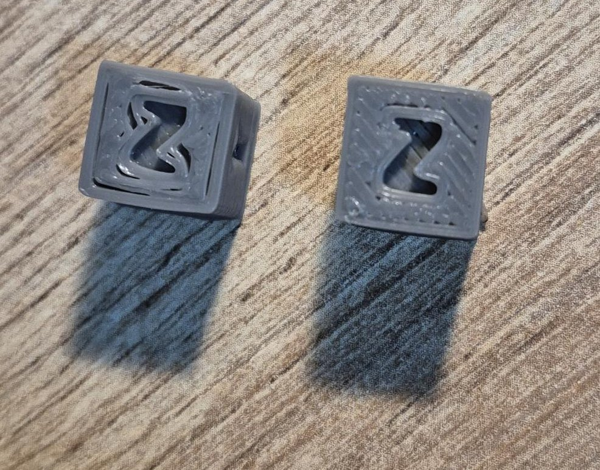
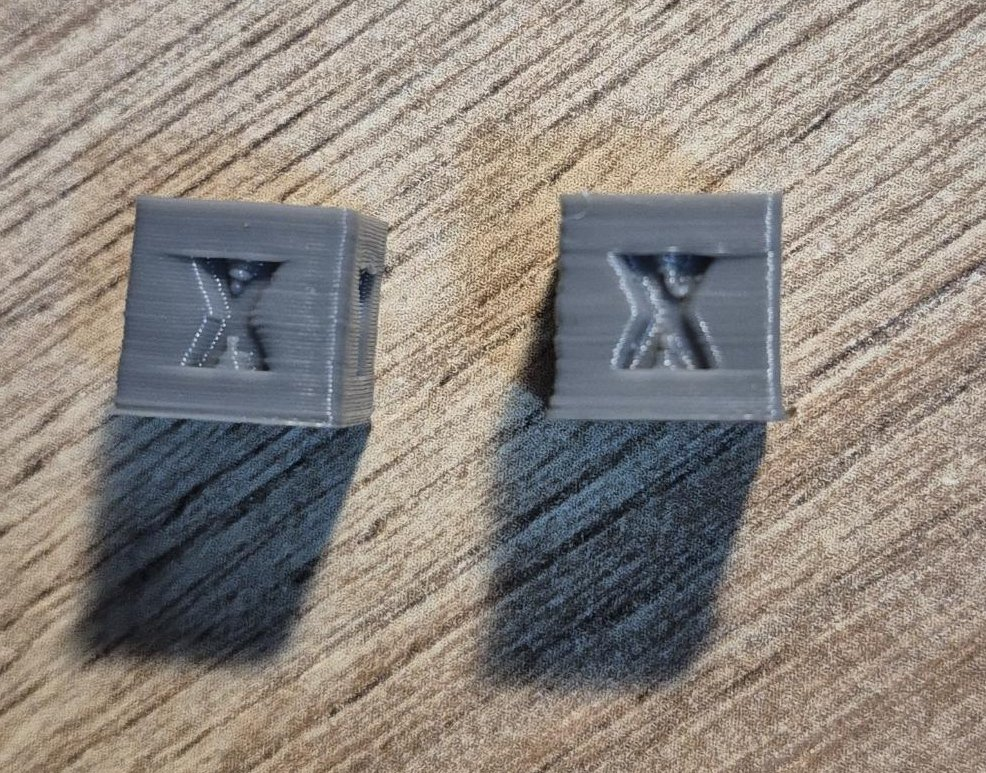

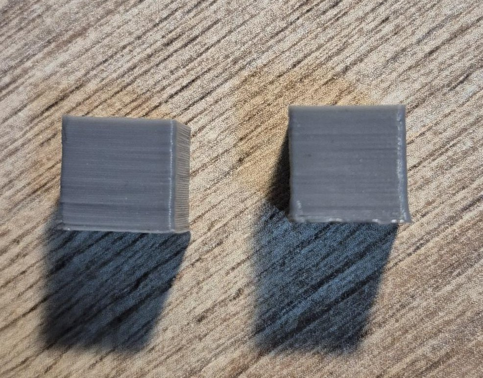

Photos of the Smoothieware cube are in [`docs/images/`](../../docs/images/) (`first-print-cube-*.jpg`).

## Three-way comparison: stock, Klipper on acrylic, Klipper on glass

Left to right in each photo: **stock Smoothieware**, **Klipper on the acrylic bed**, **Klipper on the 120 mm glass plate** (clamped, recalibrated).

| | Stock | Klipper, acrylic | Klipper, glass |
|---|---|---|---|
| Top (Z) | messy, blobbed Z | clean Z, even lines | clean Z, top slightly rougher |
| X / Y letters | crisp | crisp | crisp |
| Bottom face | smooth, glossy | smooth, glossy | **separate lines with gaps between them** |
| Bottom edge | square | elephant's foot | **small lip or ridge** |
| Walls | smoothest | slightly textured | most textured, some stringing |
| Size (ruler) | about 10 mm | about 10 mm | about 10 mm |

**What the glass cube says:**
- **The first layer is now too high.** The lines on the bottom are visible with gaps between them, so they aren't squished together. On the acrylic it was squished too much. Lower Z by about **0.05 mm** with baby-stepping during the first layer, then save it.
- **The bottom lip** is probably the first layers lifting slightly: cold glass holds PLA less well than glue-coated acrylic. Use a thin layer of **glue stick on the glass**, and print the first layer slower and hotter (215 °C, 15–20 mm/s).
- **The textured walls and stringing** are untuned extrusion. Next: extruder `rotation_distance` calibration and pressure advance, then more retraction if stringing remains.
- The size is consistent and the motion is good, so what's left is first-layer height, adhesion and extrusion tuning.

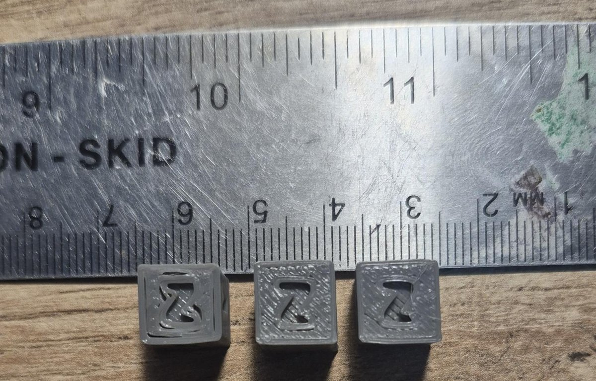
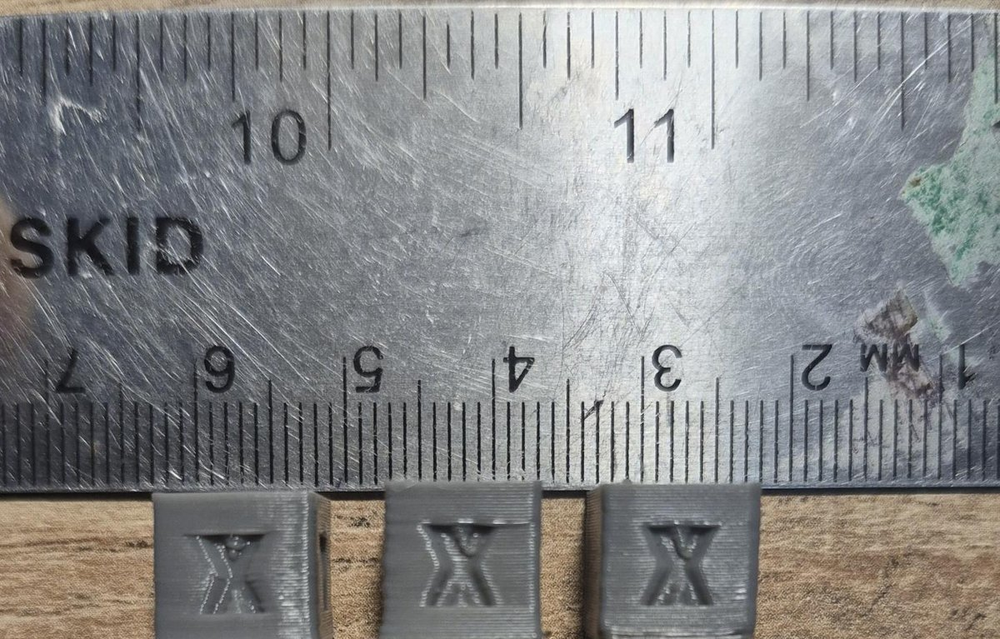
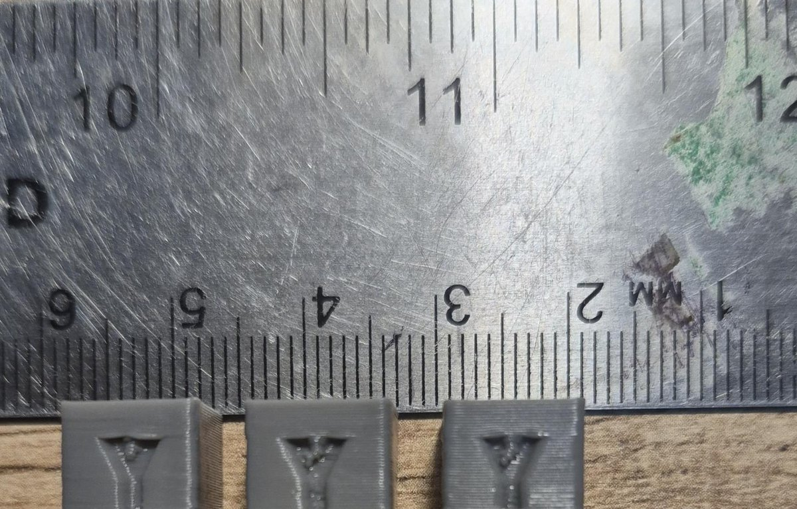
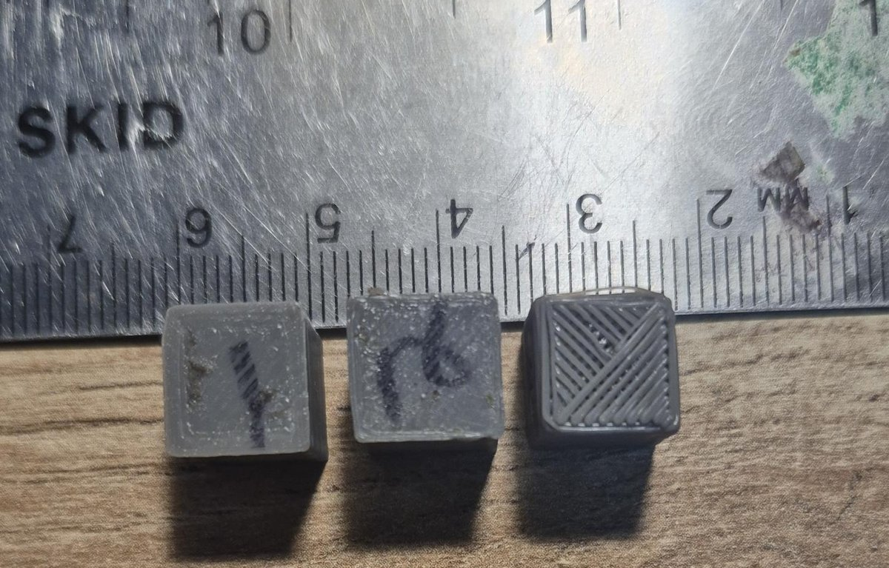
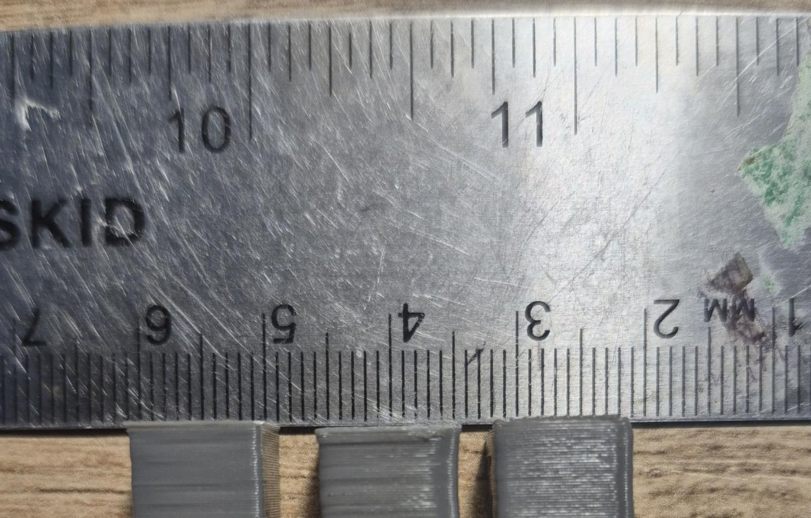

## Rounds 3 and 4 on glass (Klipper)

Left: the 3rd cube on glass. Right: the 4th, after further tuning.

- **The 4th is better:** smoother, more even walls and cleaner corners.
- **Still on both:** a small **lip at the bottom**, where the first 2–3 layers stick out slightly. That's first-layer height plus adhesion on cold glass. Use a touch more squish, glue stick, and a slower, hotter first layer. For parts that need exact dimensions at the base, use elephant's foot compensation in Cura (−0.1 to −0.2 mm).
- **Small zits on the letters** and a **string** on the 4th cube come from pressure and retraction at the start and end of lines. **Pressure advance tuning** (`TUNING_TOWER`) should fix most of it.
- **Verdict: good enough for most prints** (figures, brackets, holders). The remaining work is fine-tuning.

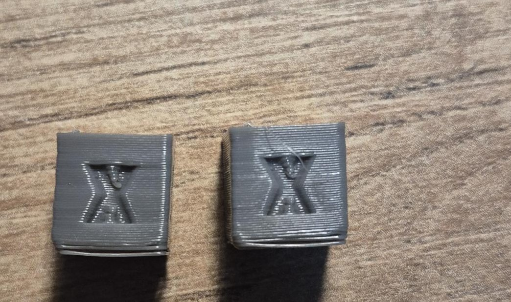
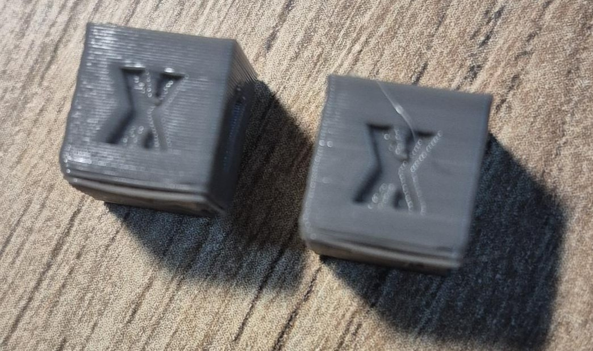

**Bottoms of rounds 3 (left) and 4 (right):** both still show **separate first-layer lines with gaps between them**. The 4th cube's lines are a little tighter, but the nozzle is still slightly too high on the glass. Lower Z another **0.02–0.05 mm** with baby-stepping, until the bottom comes out as a solid, smooth sheet, then save it. A thin layer of glue stick on the glass helps the lines bond.

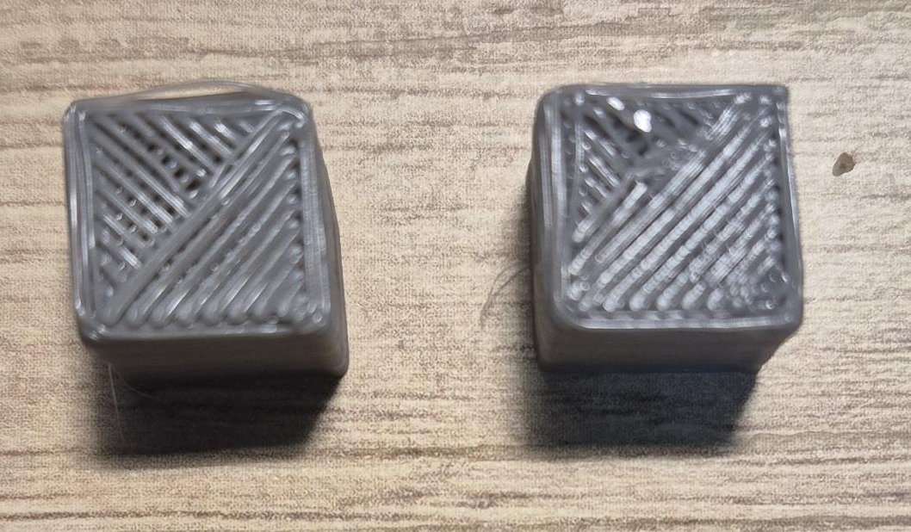

## 40 mm/s test (Klipper, glass)

The same 10 mm cube printed at 40 mm/s.

- **Walls and letters:** mostly fine at this speed. The walls are even, with small zits on the X and Y letters (pressure advance not tuned yet).
- **Top (Z):** acceptable, with some infill showing through the top surface. Add one more top layer (4–5 top layers at 0.2 mm), or slow the top surface down.
- **Bottom: clearly worse.** It's messy and stringy, with gaps between the lines, and a separated **lip around the bottom edge** on every side. The first layer isn't bonding to the glass.
  - Keep the **first layer at 15–20 mm/s** even when the rest prints at 40. In Cura, "Initial Layer Speed" is separate from the print speed.
  - Lower Z by another **0.03–0.05 mm** (the bottom should print as a solid sheet), and use a thin layer of **glue stick** on the glass. Print the first layer a little hotter (215 °C), with the **fan off or low for the first 1–2 layers** if the heatsink fan wiring allows it. On this printer the heatsink fan shares the part-fan output, so keep it on and rely on speed and temperature instead.
- **Verdict:** 40 mm/s is fine for walls. The weak point is the first layer on cold glass, so fix the first-layer settings before going faster.

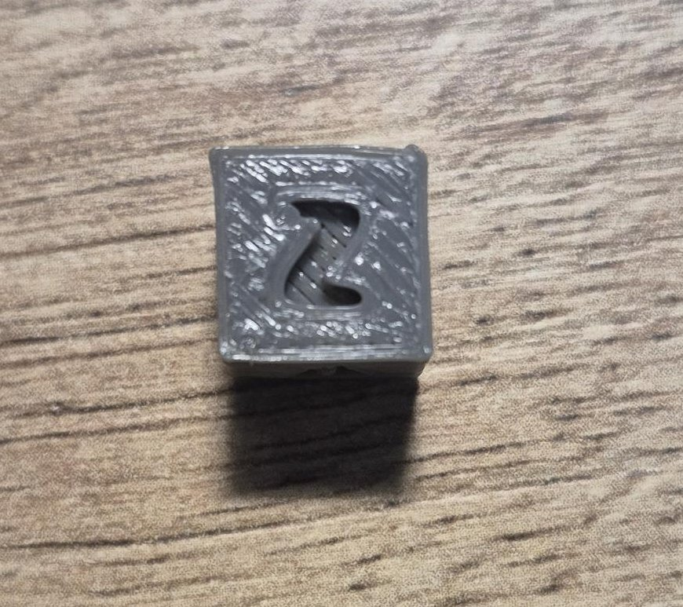
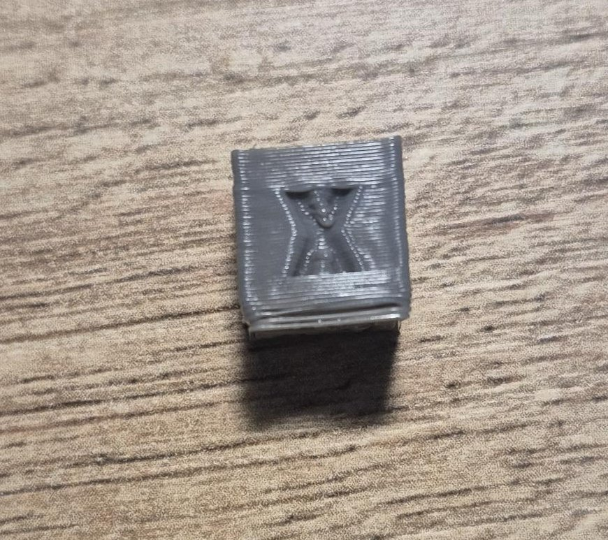
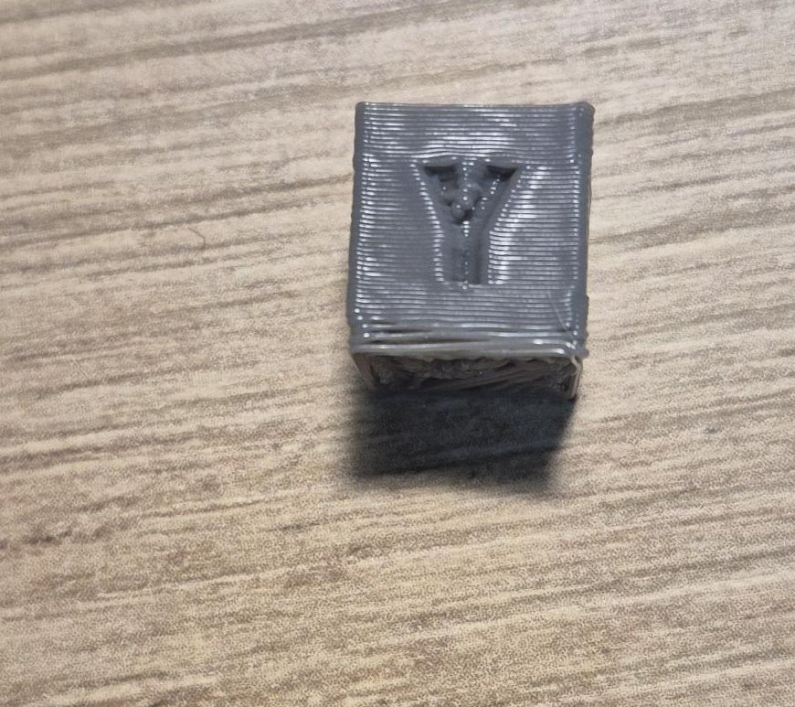
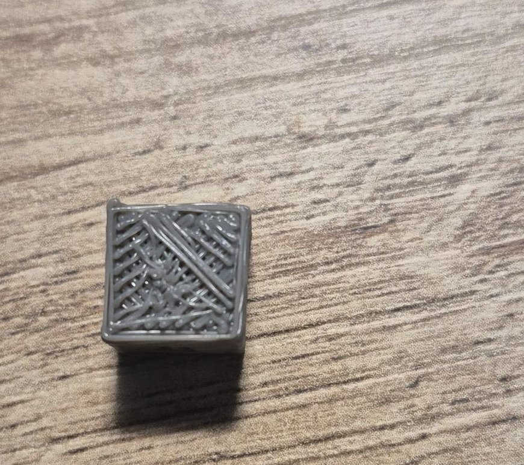
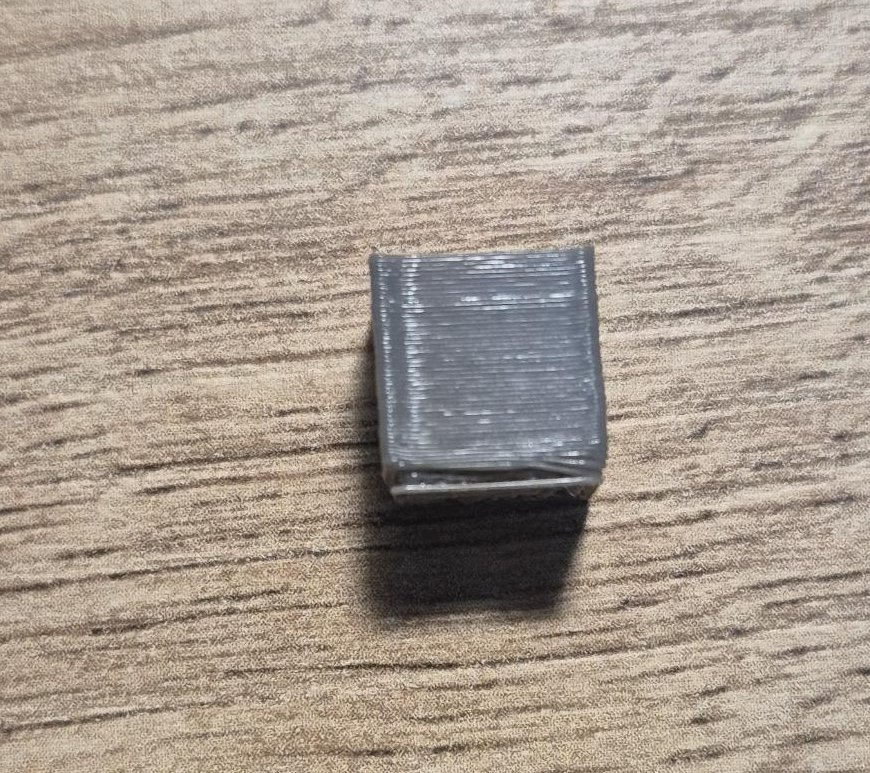
