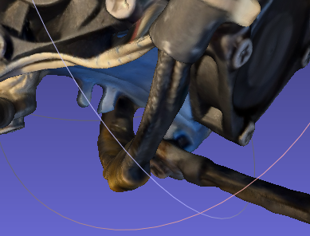
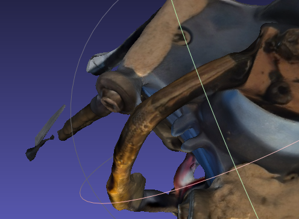

# Effector photogrammetry scan (KIRI Engine)

The original KIRI export (OBJ + MTL + 2048 px texture, 250k triangles, 29 MB) froze the server when opened in a viewer. These are decimated, untextured copies:

| File | Triangles | Size |
|---|---|---|
| `effector-scan-20k.stl` | 20k | 1 MB (open this one first) |
| `effector-scan-50k.stl` | 50k | 2.5 MB |

**Scale is NOT real.** KIRI exports in arbitrary units (the model spans about 1.5 units). To use it for measurements, scale it using one known caliper dimension (for example, the fan's 30 mm or 40 mm frame, or the rod-end eye spacing).

Use it as a visual reference for the probe saddle clip (band + 2 lugs, rod-end clearance). Read precise numbers with calipers, not from the scan: photogrammetry is smoothed and has blobs around thin features like the lugs.

Headless tips (no viewer needed):

```
python3 -c "import trimesh;m=trimesh.load('effector-scan-20k.stl');print(m.extents,len(m.faces))"
```

Avoid opening the original 250k textured OBJ in a GUI on the server; if it's needed, use MeshLab with "Quadric Edge Collapse Decimation" first, or Blender's Decimate modifier.

## The tabs ARE in the scan (MeshLab, textured)




Daniel can see the lugs in MeshLab with the texture on. If a headless check "can't see the tabs", it's because:

1. **The decimated STLs lose them.** At 20k/50k triangles, small features a few mm wide get collapsed. Use the full 250k `3DModel.obj` for the tab area.
2. **Untextured geometry hides them.** The blue color against the dark wires is what makes them stand out; the shape alone is a small bump.
3. **They're on the underside**, partly hidden behind the hotend wires and the rod end. Look from **below**, up at the band (second screenshot).

The original files are now in this folder: `3DModel.obj` + `3DModel.mtl` + `3DModel.jpg` (keep them together for the texture). **Don't open them in a GUI on the server.** For headless work, load with trimesh and crop the region around the lugs instead of rendering the whole model:

```
import trimesh
m = trimesh.load('3DModel.obj', force='mesh')
# then slice/crop around the band (find it with m.bounds and a few section planes)
```

Still: read the lug sizes with calipers. The scan only shows where they are and how many (the screenshots show them hanging down from the band, which matches the side photo).
