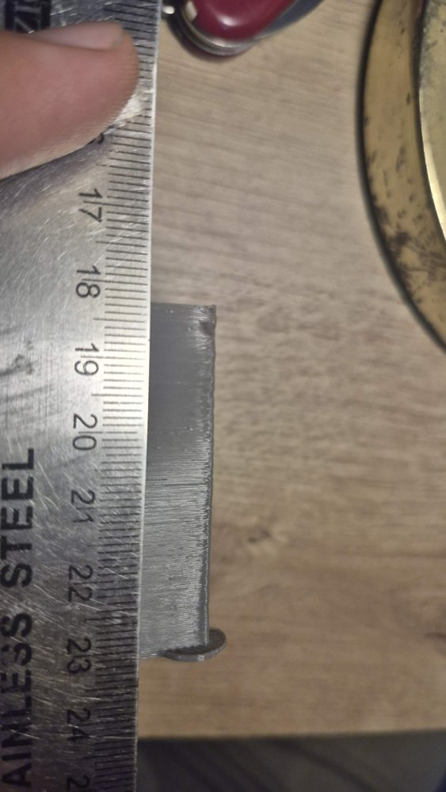
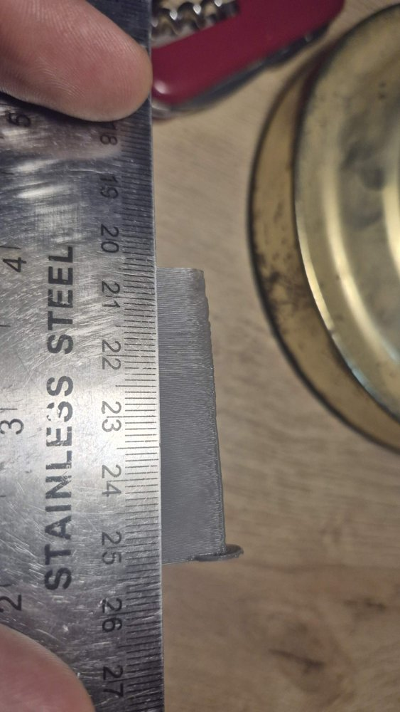
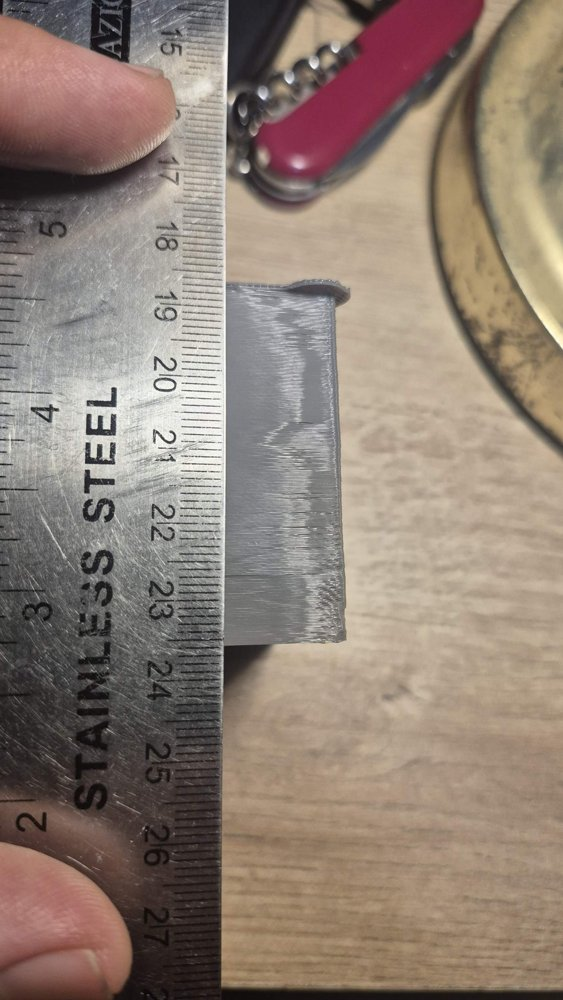
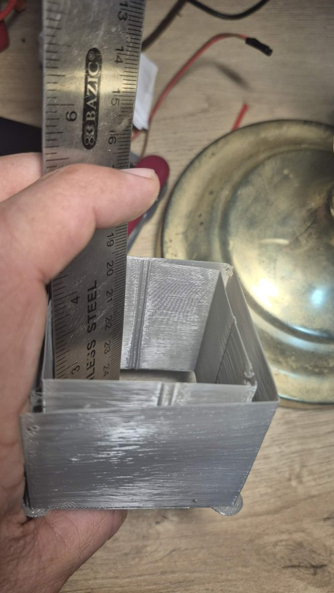

# Pressure advance tuning (Klipper tuning tower)

`pa_tower_40.stl` is a plain 40 × 40 × 40 mm block. Slice it **hollow** (see below) so only the walls print, and Klipper raises pressure advance a little every layer. Where the corners look sharpest, read the height, and that height gives the value.

## Slicer (Cura) settings for this print only
- Wall Line Count **1** (or 2), Top Layers **0**, Infill **0 %**, Bottom Layers 2–3.
- Print speed / Outer Wall speed **80 mm/s**: PA effects only show at speed. `max_velocity` is 100, so 80 is fine.
- 0.2 mm layers, normal temperature. No ironing, no "Pressure Advance" or coasting in the slicer.

## Before printing (Mainsail/Fluidd console)
```
SET_VELOCITY_LIMIT SQUARE_CORNER_VELOCITY=1 ACCEL=500
TUNING_TOWER COMMAND=SET_PRESSURE_ADVANCE PARAMETER=ADVANCE START=0 FACTOR=.020
```
FACTOR .020 is for a **Bowden** extruder (the Magician's is on top). Pressure advance goes from 0 at the bottom to 0.8 at 40 mm. Then print the file. TUNING_TOWER resets after a restart, so start the print right after.

## Reading it
1. Look at the corners from top to bottom. Low on the tower the corners **bulge** (too little PA). Higher up they turn **sharp**. Too high they get **rounded / gappy, or the wall thins right after the corner**.
2. Find the **lowest height where the corners look sharpest**, and measure it from the bed side with a ruler or calipers (in mm).
3. **PA = height × 0.020**. For example, 22 mm gives 0.44.
4. Put it in `printer.cfg` under `[extruder]`: `pressure_advance: 0.44`, then `RESTART`.

A close-up photo of one corner with a ruler next to it makes it easy to double-check.

## Result (Klipper square_tower, 100 mm/s, START=0 FACTOR=.020)

**`pressure_advance: 0.50`** (set on the server 2026-11-25; 0.55 was the first suggestion)

- First attempt (the 40 mm cube) printed at about 30 mm/s because Cura's wall speeds stayed low, and the effect was invisible. **The wall speeds themselves must be high**, not just Print Speed.
- Second attempt: Klipper's own `square_tower.stl` at 100 mm/s. Corners are clean at the bottom. From **about 33–36 mm** (measured on four corners) they show dotted gaps after the corner, which means too much PA. Some corners stay clean higher: on a delta each corner uses a different motor mix, so go by the worst one.
- Suggested first: about 28 mm × 0.020 = 0.55. **Set: 0.50**, a little more margin, since the bottom corners were already clean (no bulging even at PA 0) and photo readings are only good to 1-2 mm. If small parts show gaps after corners, drop to 0.45. If corners bulge, try 0.55–0.60.
- Note: this ruler's 0 is about 3.5 mm above its end. Heights above include that offset.






Done on the server: `pressure_advance: 0.50` under `[extruder]`, Klipper restarted (PA 0.5, accel 1500, SCV 5 confirmed).
