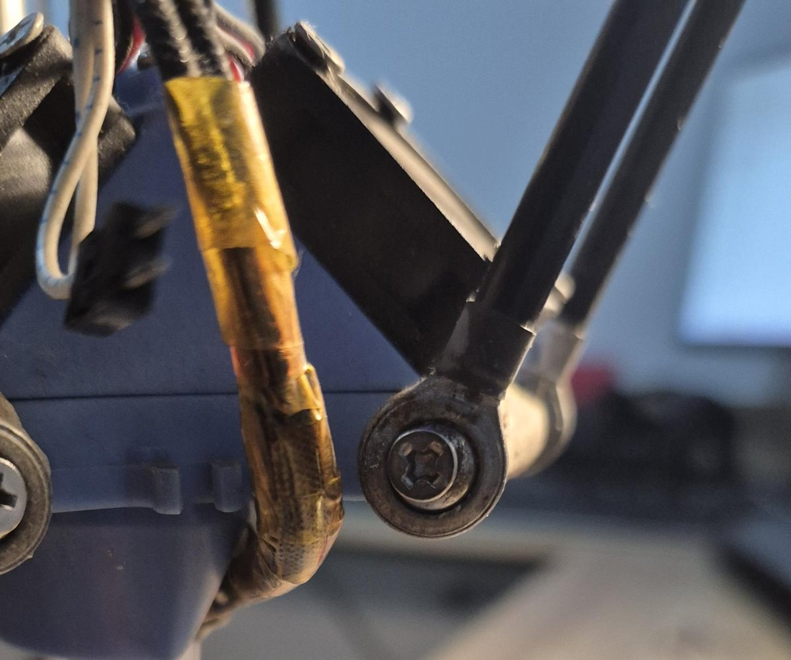
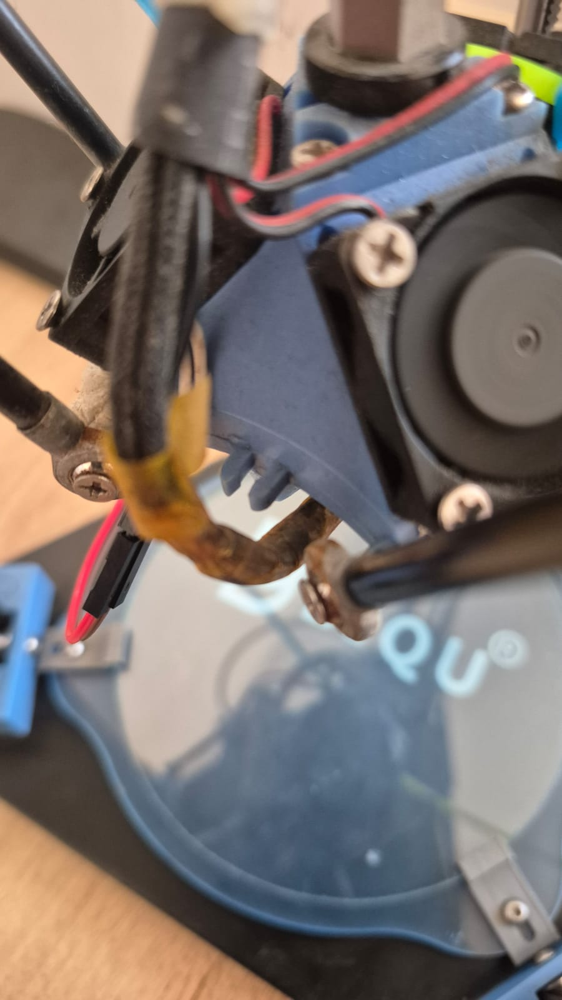
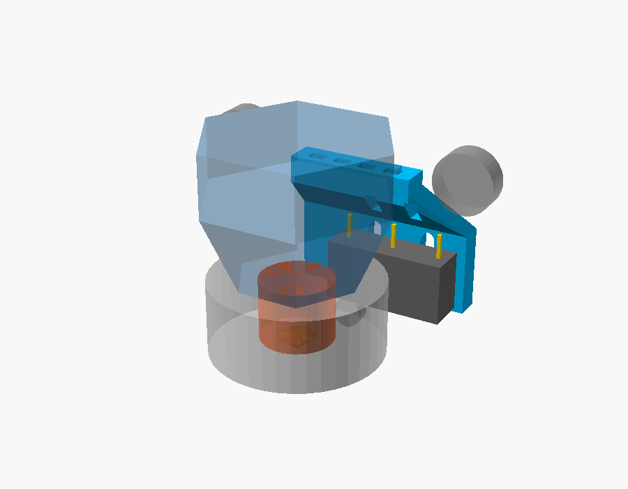
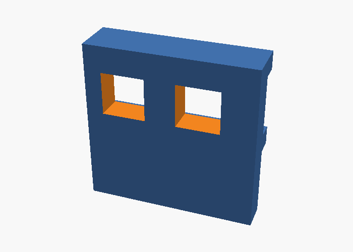
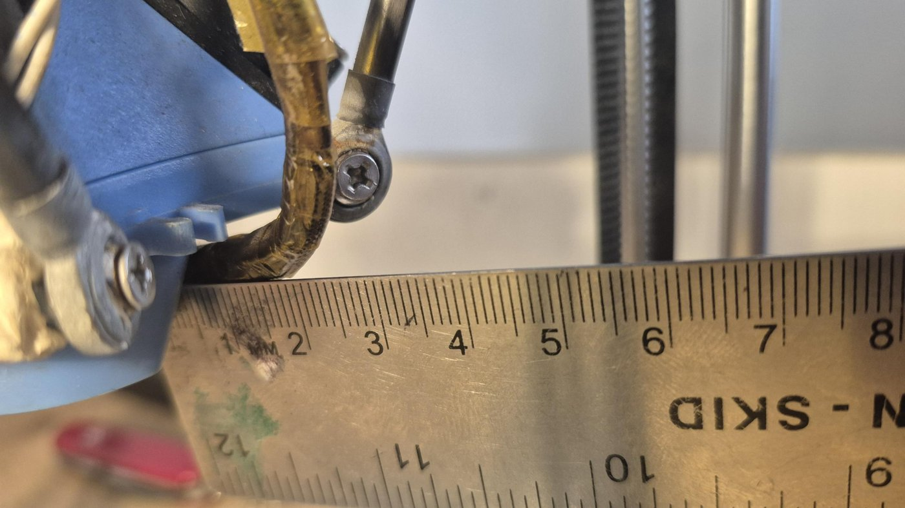
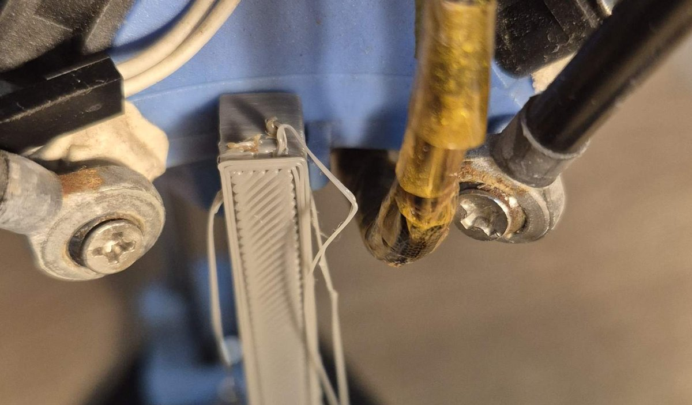
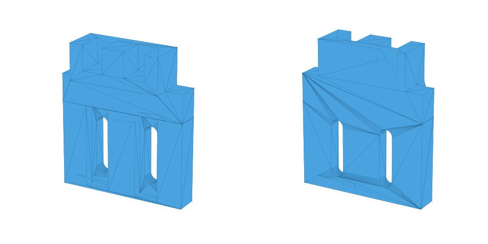

# Removable Z-probe bracket (SS0505A microswitch)

A clip-on bracket for the roller-lever microswitch probe described in [Adding a probe](../../docs/reviving-the-magician.md#adding-a-probe). It replaces the zip-tie mount: it clips on for `PROBE_CALIBRATE` / `DELTA_CALIBRATE` and pulls off before printing.

> **Status: untested.** Every effector dimension in `probe_mount.scad` is a guess from photos. Measure first (list below), print the test clip, then print the bracket.

> The first version gripped a row of "teeth" that turned out not to exist. After the [side-photo review](#review-what-the-mount-point-really-is) the clip is now a **saddle over the band with two lug windows**.

| File | What it is |
|---|---|
| `probe_mount.scad` | Parametric model. All dimensions are variables at the top. |
| `probe_mount_test.stl` | **Print this first.** Just the saddle plus a pull tab, to check the fit on the band and lugs (about 10 minutes). |
| `probe_mount_clip.stl` | Clip version: pushes onto the raised band on the effector. Nothing to drill. |
| `probe_mount_fan.stl` | Alternative: a tab clamped under one existing M3 fan screw. |

The STLs are made from the **default (guessed) values**. Regenerate them after entering your measurements.

## How it mounts



**Clip version.** A raised band runs around the blue effector, and on one face it carries **two small square lugs** (probably the OEM snap point for a shroud). The bracket is a **saddle**: seen from the side it's a C, with an upper lip over the band's top edge, a front wall on its face, and a lower lip under its bottom edge. Two **windows in the front wall drop over the lugs**, which stops it sliding sideways and gives a positive locating click. Push it straight on, pull it straight off.

- Probing pushes the switch **up**, so the lower lip presses up into the band and the saddle seats harder instead of loosening.
- The switch's weight is outward of the band, which presses the saddle's lower part against the band face.
- Nothing positively stops it being pulled straight outward: grip comes from the lug windows and lips being snug (`fit` 0.15 per side). If it comes off too easily, lower `fit` to 0.1 and reprint the test piece. If the band turns out to have no step above and below (`band_t` near 0), the lips do nothing and the windows do all the work.
- The saddle is kept narrow on the side toward the **hotend cable and rod-end eye** (`margin_r`), and the switch hangs toward the **other** side (`sw_dir = -1`). The console warns if the bracket overlaps the cable or reaches an eye.



*The first, angled photo of the lugs, which made them look like a row of downward teeth.*

**Fan-screw version.** A tab goes under one fan screw (use a screw about 3 mm longer). One screw alone would let the bracket swing, so two small lips hook the fan frame's bottom and side edges at that corner.

**Switch plate (both versions).** The switch sits on the inner face of the plate (toward the nozzle), held by two **M2 screws through vertical slots**, with **M2 nuts in grooves on the outer face** so they can't spin. Slide the switch up or down to set the roller **3–5 mm below the nozzle tip**, then tighten. Two zip-tie slots just above the switch hold the brown and red wires flat against the plate, clear of the lever.



| Clip, inner side (switch side) | Clip, outer side (lug windows, nut grooves) | Test piece |
|---|---|---|
|  |  |  |


## Measure these first

Calipers if possible. Coordinates: from the **nozzle tip**, *out* = straight away from the nozzle through the middle of the face with the lugs, *up* = vertical.

**The band and lugs (clip version)**

| Variable | Measure | Controls |
|---|---|---|
| `band_h` | band height, bottom edge to top edge | gap between the lips (plus `fit` each side) |
| `band_t` | how far the band stands proud of the body just above and below it | how deep the lips hook |
| `band_r` | nozzle axis to the band's outer face, measured level at the lugs | how far out the saddle sits |
| `band_z0` | nozzle tip up to the band's **bottom** edge | how high the saddle is, so the plate length |
| `lug_n`, `lug_w`, `lug_h` | number of lugs (2), each lug's width and height | window size |
| `lug_pitch` | lug centre to centre (or: left edge to left edge) | window spacing: the most important number |
| `lug_t` | how far a lug sticks out from the band face | must stay under `front_t` (2.4) |
| `lug_z0` | nozzle tip up to the lugs' bottom edge | window height on the front wall |
| `cable_x`, `cable_w` | where the Kapton-wrapped hotend cable crosses the band (sideways from the lug centre) and its width | cable warning; 0 = no cable there |
| `face_angle` | which way that face points: toward tower C (back) = 90, A (front-left) = 210, B (front-right) = 330 | only for the offset estimate |

**Around the nozzle**

| Variable | Measure | Controls |
|---|---|---|
| `heater_reach` | nozzle axis to the side of the heater block facing the lugs | how close the switch can get: switch inner face = `heater_reach + 8` |
| `heater_zmin`, `heater_zmax` | heater block bottom and top above the nozzle tip | preview only |
| `joint_x`, `joint_z` | centre of each rod-end eye on that face: sideways from the lug centre, height above the nozzle tip. The side photo puts one about 11 mm past the right-hand lug, at lug height | rod-end clearance warning; the tightest constraint |

**The switch (confirm the defaults)**

| Variable | Default | Measure |
|---|---|---|
| `sw_l`, `sw_h`, `sw_t` | 20 × 10 × 6.4 | body size |
| `sw_hole_d`, `sw_hole_pitch` | 2.3, 9.5 | hole size and spacing |
| `sw_hole_end` | 5.25 | roller end of the body to the nearer hole centre |
| `sw_hole_act` | 7.1 | lever face of the body (where the lever is hinged) to the hole centres |
| `roller_drop` | 6.0 | lever face to the bottom of the roller, lever at rest |
| `roller_in` | 2.5 | roller end of the body to the roller centre, along the length |

**Fan-screw version only:** `fan_screw` (the x/out/up position where the chosen screw head sits now), `fan_tilt` (how far that fan face leans from vertical), `fan_corner` (which side the frame's outer edge is on), `fan_edge` (screw centre to the frame's bottom and side edges).

After editing, open the file in OpenSCAD with `part = "assembly"` (or `"assembly_fan"`) and read the console. It prints the roller position, the estimated probe offsets, and a `WARNING` if the switch terminals hit the saddle, the plate sits too close to the roller, the bracket overlaps the hotend cable, or it reaches a rod-end eye.

## Printing

Regenerate the STLs:

```
openscad -D 'part="test"' -o probe_mount_test.stl probe_mount.scad
openscad -D 'part="clip"' -o probe_mount_clip.stl probe_mount.scad
openscad -D 'part="fan"'  -o probe_mount_fan.stl  probe_mount.scad
```

- **Orientation: upright, exactly as exported** (plate standing vertical, saddle on top). No supports needed: the upper lip only juts 1.35 mm inward, the gusset under the saddle is about 30° from vertical, and the window and slot tops are short bridges.
- The footprint is about 26 × 4 mm on a 25 mm tall part: use a **brim** (3–5 mm).
- PLA or PETG, 0.2 mm layers, 3 walls, 40%+ infill. PETG copes better with heat if the hotend sits near the switch for long calibration runs.
- Slow it down or use a minimum layer time of about 10 s: the saddle layers are small (see the lesson from the [glass clamps](../glass-clamp/)).

## Expected result

With the default numbers the roller ends up **about 17 mm out from the nozzle axis**, directly in line with it (`roller_x = 0`). That's set by the hotend, not by the bracket: the switch's inner face has to stay `min_clear` = 8 mm from the heater block, and the roller sits in the middle of the 6.4 mm switch, so the roller can't get closer than about `heater_reach + 8 + 3.2`. If `heater_reach` turns out smaller, the roller moves in by the same amount. Lowering `min_clear` to 5 (PETG) gains another 3 mm.

The current zip-tied switch measured **10 mm** with the dot method (it sits closer than 8 mm to the block), so the bracket will be a few mm **farther out**, not closer. In exchange it's rigid, repeatable, and comes off in a second.

**New offsets estimate:** the console prints `x_offset`/`y_offset` from `face_angle`. With the defaults (lug face pointing back toward tower C) that's `x_offset: 0`, `y_offset: 17.2`. **This is only an estimate.** After fitting:

1. **Remeasure X/Y with the dot method** ([steps](../../docs/reviving-the-magician.md#probe-remounted-closer-to-the-nozzle)): the toolhead position with the nozzle over a marked dot is X1/Y1, and with the roller over the same dot it's X2/Y2; `x_offset = X1 − X2`, `y_offset = Y1 − Y2`. A roller toward the back (tower C) gives a positive `y_offset`.
2. `QUERY_PROBE`: open at rest, TRIGGERED when the roller is pressed.
3. `PROBE_CALIBRATE`, paper test with `TESTZ`, `ACCEPT`, `SAVE_CONFIG`. `z_offset` should drop from 13.15 to about 3–5.
4. `DELTA_CALIBRATE` (radius 45). `horizontal_move_z` can come down to about 10 now the roller hangs only 3–5 mm.
5. **Unclip it before printing.**

## Not included

A flip-up/retracting version: it needs a hinge and a latch that hold the roller to repeatable height, which adds slop the clip doesn't have. Pulling the clip off is quicker and more repeatable.

## Review: what the mount point really is


A level side photo shows that the "teeth" in the earlier angled photo are **not downward-pointing teeth with a gap behind them**:

- There is a **raised horizontal band (rib)** around the blue effector, a few mm tall, just above the lower body.
- On that band sit **two small square lugs** (roughly 3–4 mm wide, with a gap of about the same between them) that stick **outward** from the band. They look like snap lugs for an OEM shroud or duct.
- **2 lugs, not 4.** Nothing hangs below the effector for pockets to slide over, and there is no `tooth_gap` behind them.
- The **rod-end eye is very close**: about one lug-width to the right of the lugs, at roughly the same height. Clearance there is the tightest constraint.

**So the comb clip (pockets sliding up from below, tongue behind the teeth) had nothing to grip.** It was replaced by the saddle described [above](#how-it-mounts), following the redesign suggested here: lips over and under the band, two windows over the lugs, a narrow saddle that stops short of the rod-end eye and cable, the switch plate unchanged, and probing force seating it upward.

Also checked in that review: it said `probe_mount_fan.stl` was not watertight. That was wrong. PrusaSlicer reports all three STLs as manifold, single-part meshes, and an edge-pairing check finds no open edges.

### Ruler photos (rough, from photos; confirm with calipers)



Scale: about 225 px/cm at the ruler edge. Perspective makes these approximate (±1–2 mm):

- **Tab width:** about **2–2.5 mm** (along the face). It hangs **down** from the band, about 3–4 mm tall.
- **Tab to rod-end eye:** about **13 mm** from the tab's edge to the eye's edge, about **17 mm** to the eye's centre. The eye's bottom sits roughly level with the tab's bottom (slightly higher).
- So the saddle can extend **at most about 10 mm** sideways from the tab toward the rod end (2–3 mm clearance kept).

Other photos (purpose unclear, kept for reference): [under the effector](images/ruler-under-effector.jpg), [tilted ruler at the tab](images/ruler-tab-tilted.jpg).

Still needed: number of tabs and the gap between them (straight-on close-up), how far each tab sticks out, and **nozzle tip to the tab bottom** (move to `G1 Z50`, measure bed → tab bottom, subtract 50).

### Tab gauge (`tab_gauge.stl`): print this before any saddle

The scan can't give real dimensions (KIRI scale is arbitrary and it smooths small features), so measure the tab by fit. `tab_gauge.stl` is a 45 × 6 × 8 mm bar with six slots, 4 mm deep and 6 mm tall, open at the top:

| Notches on the front | 1 | 2 | 3 | 4 | 5 | 6 |
|---|---|---|---|---|---|---|
| Slot width (mm) | 2.0 | 2.3 | 2.6 | 2.9 | 3.2 | 3.6 |

Print flat (as exported), 0.2 mm layers, no supports, about 5 minutes. Push each slot up over a tab from below. The **narrowest slot that slides on with light friction** is the pocket width. Then report the slot number, plus how far the tab sits inside the slot (that's how far it sticks out).

**Gauge result 1:** even slot 6 (3.6 mm) only went halfway on, and needed force. The tab is **wider than 3.6 mm**, or it tapers (wider at the root). The photo estimate of 2–2.5 mm was wrong.

**`tab_gauge_2.stl`:** slots 3.8, 4.1, 4.4, 4.7, 5.0, 5.4 mm (1–6 notches), 6 mm deep, 7 mm tall.

**Gauge result 2:** slot 1 (**3.8 mm**) slides fully on, snug. Since 3.6 mm only went halfway with force, **use 3.8 mm as the pocket width** (printed holes run slightly undersized, so the tab itself is probably about 3.6–3.7 mm). The tab fits fully in a slot 6 mm deep and 7 mm tall, so it sticks out less than 6 mm and hangs less than 7 mm.

**2 tabs** confirmed. 

**`tab_spacing_gauge.stl`:** six blocks, each with two 3.8 mm pockets at edge-to-edge gaps of 2, 3, 4, 5, 6 and 7 mm (1–6 notches). The block that seats on both tabs at once gives the spacing.

**Tab gap: about 4 mm edge to edge.** Daniel: the gap between the tabs equals the gauge's wall. In gauge 2, slot 1 sits 4 mm from the end and the slots are 4 mm apart, so the gap is about 4 mm. Block 3 of the spacing gauge (3 notches, 4 mm) should confirm it.

So far: **2 tabs, pocket 3.8 mm wide, gap 4 mm (tab centres about 7.8 mm apart), tab sticks out < 6 mm, hangs < 7 mm.** Still needed: nozzle tip to tab bottom.

## Clip v2 (from real measurements): `probe_clip_v2.stl`



Generated by `saddle_clip.py` (manifold3d; edit the numbers at the top and rerun). It replaces the guessed `probe_mount.scad` parts.

**Inputs:** 2 tabs, pocket 3.8 mm wide (gauge 2), gap 4 mm, tab height about 3.5 mm (pockets 4.5 deep), and the band underside **29.5 mm above the nozzle tip**: 76 mm on the ruler + 3.5 mm of unmarked ruler end (measured against the ruler itself) = 79.5 mm at `G1 Z50`.

**Shape:**
- A 16.6 mm wide block whose top presses against the band. Two pockets slide up over the tabs, open toward the effector (the tab's thickness doesn't matter), with a 2 mm wall outside them.
- A 23 × 4 mm plate hangs below it. The **switch goes on the outer face** (away from the heater), with two M2 screws in 10 mm vertical slots and nut grooves on the inner face.
- Roller: about 7.5 mm to one side of centre, about 5 mm outside the tab face. Its height is adjustable from 8 mm below the nozzle tip up to level with it; set it **3–5 mm below**.

**Print:** upright as exported, brim, PLA, 0.2 mm, 3 walls. Print `probe_clip_v2_test.stl` first (block + tab, about 10 min) to check the fit on both tabs.

Then remeasure the X/Y offsets with the dot method, then `PROBE_CALIBRATE`. Unclip it before printing.

**Update:** the pockets are now **closed on all four sides** (3.8 × 6.0 mm, with a 1 mm inner wall), exactly like gauge 2's slot. An open-sided pocket only gripped the tab by friction and could slide off outward. A closed pocket boxes the tab in, so the clip can't come off sideways or outward, only straight down.

### Screwless version: `probe_clip_v2_pins.stl`

The same clip, but instead of M2 screws in slots, the plate has **two 2.1 mm pins** (9.5 mm apart, 7.2 mm long) that go through the switch's 2.3 mm holes. Push the switch on, then melt the pin tips with a soldering iron (rivet heads), or add a drop of glue.

- **No height adjustment:** the roller is fixed at about 4 mm below the nozzle tip, assuming the standard switch dimensions (hole pitch 9.5, holes 7.1 mm above the lever face, roller about 6 mm below the lever face). Check the roller with `QUERY_PROBE` and the paper test. If it ends up too high or low, `PROBE_CALIBRATE` takes care of the Z offset; it only needs to hang 3–5 mm below the nozzle so the nozzle doesn't touch the glass first.
- **Print lying on its back** (plate face down, pins pointing up), so the pins print as round columns, which is the strongest direction for them.

**Switch checked from a photo** ([switch-holes.jpg](images/switch-holes.jpg)): the holes sit near the **terminal** edge, about 2.4 mm below it (so about 7.6 mm above the lever face), and about 9.4 mm apart (9.5 is assumed). `hole_act` is updated to 7.6 and the STLs regenerated.

**Correction after the test print:** the pocket spacing was too wide. The gap between the tabs equals gauge 2's **1 mm side wall**, not the 4 mm end wall. So gauge 2 sat with its 3.8 mm slot width **across** the tab (radial) and its 6 mm slot depth **along** the face. The pockets are now 6.0 mm along the face × 3.8 mm radial, with a **1 mm wall between them**, the same as the gauge.

## Clip v3: tabs go in from the side, lever points down (`side_clip_v3.py`)

Daniel corrected the mounting logic: the clip pushes onto the tabs **horizontally**, and the switch hangs **vertically** with the lever/roller pointing down.

- `probe_clip_v3_test.stl`: just the block, 17 × 8.5 × 7.8 mm. Two pockets open on the face that touches the effector: **6.0 mm wide × 3.8 mm tall, 6.5 mm deep, 1 mm wall between them**.
- `probe_clip_v3.stl`: block plus a vertical plate hanging below it, with **two 2.1 mm pins 9.5 mm apart (vertical)** for the switch. The switch body runs vertically from 2 to 22 mm above the nozzle tip, roller at the bottom, terminals toward +X.

**Estimates to check:** the tab centre height (27 mm above the nozzle) and the roller drop below the switch body (7 mm). The target is the roller about 5 mm below the nozzle tip. Being 2–3 mm off is fine, since `PROBE_CALIBRATE` measures the real offset; the roller only has to hang below the nozzle.

Print the test block first. Then print the full clip lying on its back, plate face down, pins up.

### `probe_clip_v2_test_pins.stl` (Daniel's idea)

The v2 test block (it fits the tabs) with **two 2.1 mm pins, 9.5 mm apart, horizontal**, on the **inner face of the lower part** (the same side the clip block sticks out), 2.4 mm below the block. They point toward the nozzle. The switch tucks under the block, terminal edge against the block's underside, lever pointing down. Exported **flat side down, pins up**: the whole outer face is flat, so **no supports** are needed. Check the roller hangs below the nozzle tip before probing.
