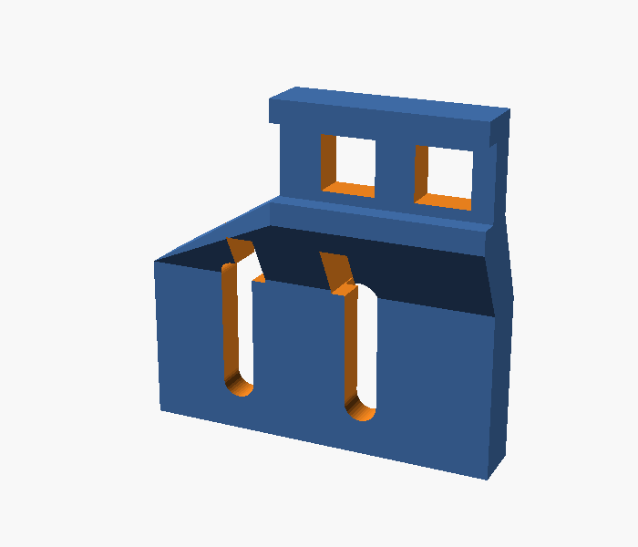
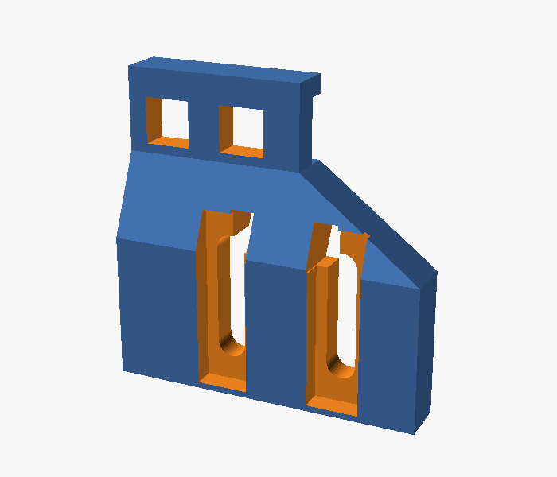
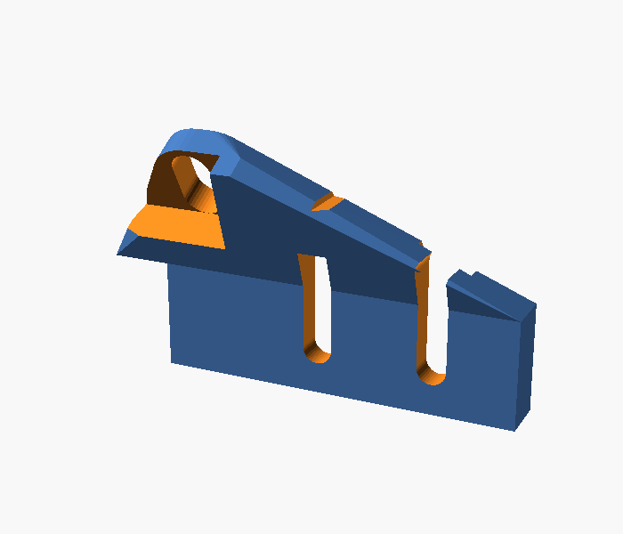

# Removable Z-probe bracket (SS0505A microswitch)

A clip-on bracket for the roller-lever microswitch probe described in [Adding a probe](../../docs/reviving-the-magician.md#adding-a-probe). It replaces the zip-tie mount: it clips on for `PROBE_CALIBRATE` / `DELTA_CALIBRATE` and pulls off before printing.

> **Status: untested.** Every effector dimension in `probe_mount.scad` is a guess from photos. Measure first (list below), print the test clip, then print the bracket.

> ⚠️ **Review (side photo): the clip geometry is wrong, redesign needed.** See [Review: what the mount point really is](#review-what-the-mount-point-really-is) below.

| File | What it is |
|---|---|
| `probe_mount.scad` | Parametric model. All dimensions are variables at the top. |
| `probe_mount_test.stl` | **Print this first.** Just the comb socket plus a pull tab, to check the fit on the teeth (about 10 minutes). |
| `probe_mount_clip.stl` | Clip version: slides up over the molded teeth on the effector. Nothing to drill. |
| `probe_mount_fan.stl` | Alternative: a tab clamped under one existing M3 fan screw. |

The STLs are made from the **default (guessed) values**. Regenerate them after entering your measurements.

## How it mounts


**Clip version.** The bottom of the effector has a short row of molded teeth (the OEM clip point for accessories; also visible in [probe-remount-lever.jpg](../../docs/images/probe-remount-lever.jpg)). The bracket has one pocket per tooth and slides **up** over them. If there's a gap behind the teeth, a thin tongue goes into it, so the clip is boxed in front and behind. The plastic between the pockets keys between the teeth, so the clip can't slide sideways. Probing pushes the switch **up**, which seats the clip harder against the teeth instead of loosening it. If it ever feels loose, lower `fit` by 0.05 and reprint the test piece.

**Fan-screw version.** A tab goes under one fan screw (use a screw about 3 mm longer). One screw alone would let the bracket swing, so two small lips hook the fan frame's bottom and side edges at that corner.

**Switch plate (both versions).** The switch sits on the inner face of the plate (toward the nozzle), held by two **M2 screws through vertical slots**, with **M2 nuts in grooves on the outer face** so they can't spin. Slide the switch up or down to set the roller **3–5 mm below the nozzle tip**, then tighten. Two zip-tie slots just above the switch hold the brown and red wires flat against the plate, clear of the lever.


| Clip, inner side (switch side) | Clip, outer side (nut grooves) | Test piece |
|---|---|---|
|  |  |  |



## Measure these first

Calipers if possible. Coordinates: from the **nozzle tip**, *out* = straight away from the nozzle through the middle of the face with the teeth, *up* = vertical.

**The teeth (clip version)**

| Variable | Measure | Controls |
|---|---|---|
| `tooth_n` | number of teeth | pocket count |
| `tooth_w` | width of one tooth | pocket width (plus `fit` each side) |
| `tooth_pitch` | centre to centre of neighbouring teeth (easiest: first tooth's left edge to last tooth's left edge, divided by n−1) | pocket spacing: the most important number |
| `tooth_t` | how far a tooth sticks out from the surface behind it | pocket depth |
| `tooth_h` | height of a tooth | must be more than `engage` (2.5) |
| `tooth_gap` | the gap behind the teeth, if any (a feeler gauge, or a strip of paper folded until it just fits). **0 if the teeth sit on a flat face** | tongue thickness; no tongue below about 1.1 mm |
| `teeth_r` | nozzle axis to the **outer** face of the teeth, measured level | how far out the bracket sits |
| `teeth_z` | nozzle tip up to the **bottom** of the teeth | how high the clip is, so the plate length |
| `face_angle` | which way that face points: toward tower C (back) = 90, A (front-left) = 210, B (front-right) = 330 | only for the offset estimate |

**Around the nozzle**

| Variable | Measure | Controls |
|---|---|---|
| `heater_reach` | nozzle axis to the side of the heater block facing the teeth | how close the switch can get: switch inner face = `heater_reach + 8` |
| `heater_zmin`, `heater_zmax` | heater block bottom and top above the nozzle tip | preview only |
| `joint_x`, `joint_z` | centre of each rod-end eye on that face: sideways from the face centre, height above the nozzle tip | rod-end clearance warning |

**The switch (confirm the defaults)**

| Variable | Default | Measure |
|---|---|---|
| `sw_l`, `sw_h`, `sw_t` | 20 × 10 × 6.4 | body size |
| `sw_hole_d`, `sw_hole_pitch` | 2.3, 9.5 | hole size and spacing |
| `sw_hole_end` | 5.25 | roller end of the body to the nearer hole centre |
| `sw_hole_act` | 7.1 | lever face of the body (where the lever is hinged) to the hole centres |
| `roller_drop` | 6.0 | lever face to the bottom of the roller, lever at rest |
| `roller_in` | 2.5 | roller end of the body to the roller centre, along the length |

**Fan-screw version only:** `fan_screw` (the x/out/up position where the chosen screw head sits now), `fan_tilt` (how far that fan face leans from vertical), `fan_corner` (which side the frame's outer edge is on), `fan_edge` (screw centre to the frame's bottom and side edges).

After editing, open the file in OpenSCAD with `part = "assembly"` (or `"assembly_fan"`) and read the console. It prints the roller position, the estimated probe offsets, and a `WARNING` if the switch terminals hit the clip, the plate sits too close to the roller, or the bracket reaches a rod-end eye.

## Printing

Regenerate the STLs:

```
openscad -D 'part="test"' -o probe_mount_test.stl probe_mount.scad
openscad -D 'part="clip"' -o probe_mount_clip.stl probe_mount.scad
openscad -D 'part="fan"'  -o probe_mount_fan.stl  probe_mount.scad
```

- **Orientation: upright, exactly as exported** (plate standing vertical, pockets opening upward). No supports needed. The only overhang is the gusset under the clip, at about 41°. The slot tops are small arches.
- The footprint is about 30 × 4 mm on a 23 mm tall part: use a **brim** (3–5 mm).
- PLA or PETG, 0.2 mm layers, 3 walls, 40%+ infill. PETG copes better with heat if the hotend sits near the switch for long calibration runs.
- Slow it down or use a minimum layer time of about 10 s: the clip layers are small (see the lesson from the [glass clamps](../glass-clamp/)).

## Expected result

With the default numbers the roller ends up **about 17 mm out from the nozzle axis**, directly in line with it (`roller_x = 0`). That's set by the hotend, not by the bracket: the switch's inner face has to stay `min_clear` = 8 mm from the heater block, and the roller sits in the middle of the 6.4 mm switch, so the roller can't get closer than about `heater_reach + 8 + 3.2`. If `heater_reach` turns out smaller, the roller moves in by the same amount. Lowering `min_clear` to 5 (PETG) gains another 3 mm.

The current zip-tied switch measured **10 mm** with the dot method (it sits closer than 8 mm to the block), so the bracket will be a few mm **farther out**, not closer. In exchange it's rigid, repeatable, and comes off in a second.

**New offsets estimate:** the console prints `x_offset`/`y_offset` from `face_angle`. With the defaults (teeth face pointing back toward tower C) that's `x_offset: 0`, `y_offset: 17.2`. **This is only an estimate.** After fitting:

1. **Remeasure X/Y with the dot method** ([steps](../../docs/reviving-the-magician.md#probe-remounted-closer-to-the-nozzle)): the toolhead position with the nozzle over a marked dot is X1/Y1, and with the roller over the same dot it's X2/Y2; `x_offset = X1 − X2`, `y_offset = Y1 − Y2`. A roller toward the back (tower C) gives a positive `y_offset`.
2. `QUERY_PROBE`: open at rest, TRIGGERED when the roller is pressed.
3. `PROBE_CALIBRATE`, paper test with `TESTZ`, `ACCEPT`, `SAVE_CONFIG`. `z_offset` should drop from 13.15 to about 3–5.
4. `DELTA_CALIBRATE` (radius 45). `horizontal_move_z` can come down to about 10 now the roller hangs only 3–5 mm.
5. **Unclip it before printing.**

## Not included

A flip-up/retracting version: it needs a hinge and a latch that hold the roller to repeatable height, which adds slop the clip doesn't have. Pulling the clip off is quicker and more repeatable.

## Review: what the mount point really is


A level side photo shows that the "teeth" in the earlier angled photo are **not downward-pointing teeth with a gap behind them**:

- There is a **raised horizontal band (rib)** around the blue effector, a few mm tall, just above the lower body.
- On that band sit **two small square lugs** (roughly 3–4 mm wide, with a gap of about the same between them) that stick **outward** from the band. They look like snap lugs for an OEM shroud or duct.
- **2 lugs, not 4.** Nothing hangs below the effector for pockets to slide over, and there is no `tooth_gap` behind them.
- The **rod-end eye is very close**: about one lug-width to the right of the lugs, at roughly the same height. Clearance there is the tightest constraint.

**So the current comb clip (pockets sliding up from below, tongue behind the teeth) has nothing to grip. Don't print it.**

### Suggested redesign: saddle clip over the band

- An upper lip hooks over the top edge of the band and a lower lip under its bottom edge, so it snaps on horizontally or vertically.
- **Two rectangular windows** drop over the two lugs and key it against sliding sideways (and give a positive snap).
- The switch plate hangs below, as now (M2 slots, nut grooves, zip-tie slots all stay).
- Keep the saddle narrow, ending before the rod-end eyes on both sides; the side toward the joint is the critical one.
- Keep the probing force pushing the saddle **up into** the band, so it seats rather than loosens.
- Still print a quick test piece (saddle only) before the full bracket.

### Measurements needed (calipers)

1. Band height (top edge to bottom edge) and how far it sticks out from the body below it.
2. Each lug's width, height and how far it sticks out, plus the gap between the two lugs.
3. Nozzle tip up to the band's bottom edge.
4. Lugs to the nearest rod-end eye: sideways and height.
5. Heater block reach toward that face (still needed for the switch keep-out).

### Other review notes on the current files

- `probe_mount_fan.stl` is **not watertight** (it may slice badly); regenerate it after measuring.
- Expected roller distance stays about **17 mm** from the nozzle (vs 10 mm for the zip-tied switch) because of the 8 mm heater keep-out. That's fine for calibration: redo the X/Y offsets with the dot method afterwards.
