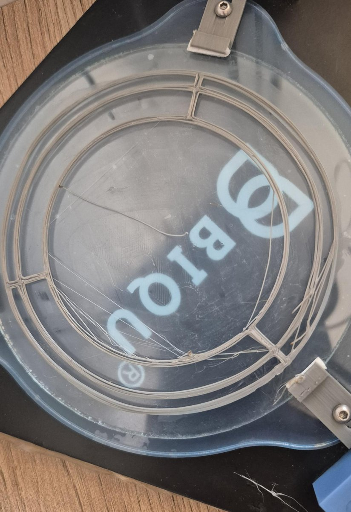
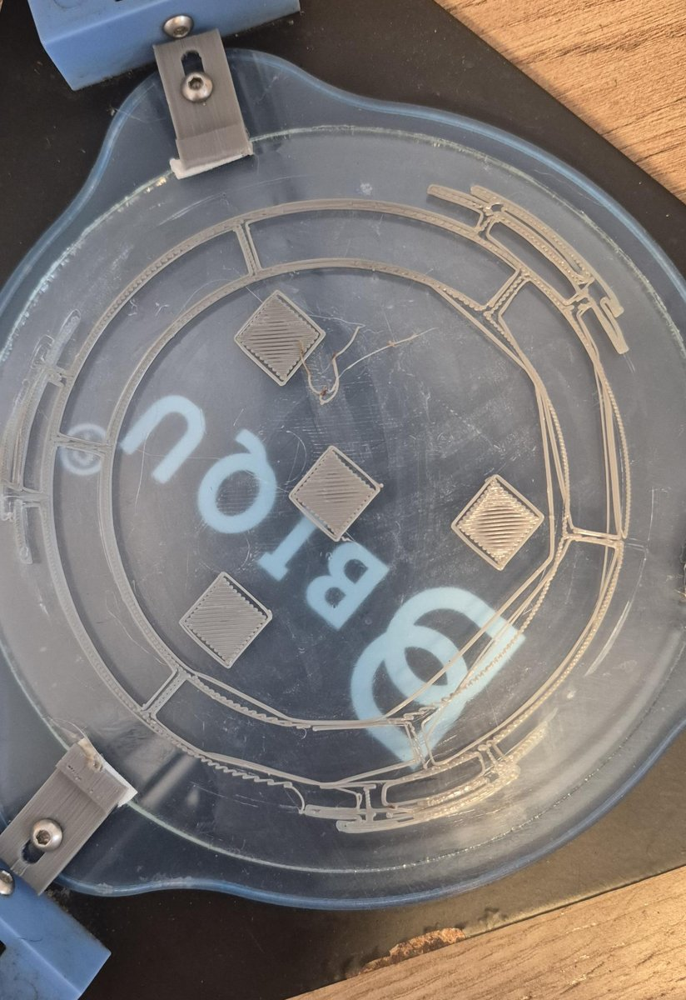
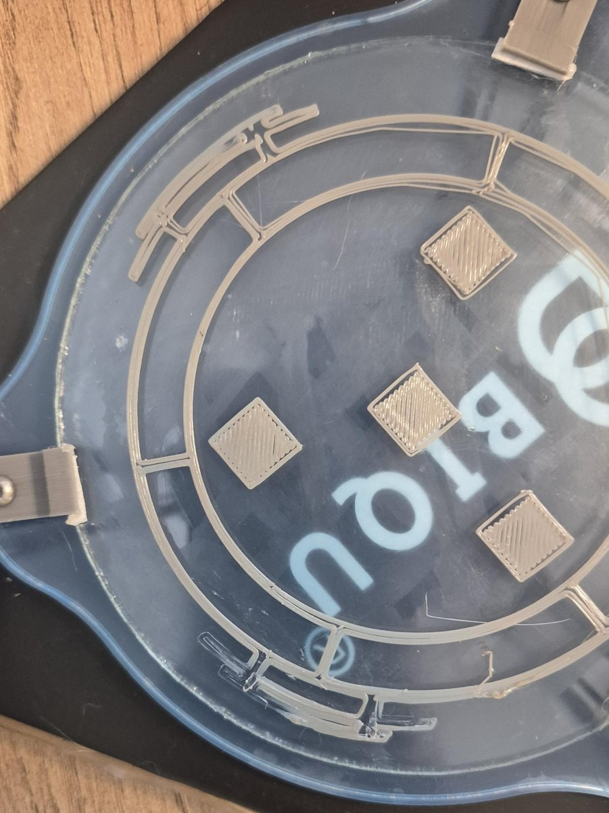
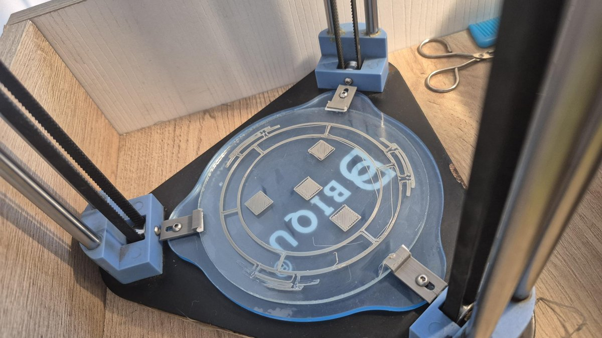

# 110 mm reach test

`reach_test_110.stl`: three 2 mm wide rings (80, 100 and 110 mm diameter), 0.6 mm tall (3 layers at 0.2), tied together by three spokes pointing at the towers. About **1.4 g** of PLA, 10–15 minutes.

What it shows: whether the effector reaches 110 mm without the arms or carriages hitting anything, and whether the first layer is even all the way to the edge (a level check of the outer bed). A ring that is thin on one side, or missing, means the edge isn't level there, or the probe calibration didn't cover it.

**Before printing:** in `printer.cfg`, `[delta_calibrate] radius` and the kinematics `print_radius` (if set) limit how far out Klipper allows moves. For a 110 mm circle, `print_radius` must be at least 55. First jog to the edge by hand at a safe height (`G1 Z10`, then e.g. `G1 X0 Y55`, `G1 X47.6 Y-27.5`, `G1 X-47.6 Y-27.5`) and watch for collisions. Keep the glass clamps outside the 110 mm circle.

## Result (glass bed, Klipper)

- **Reach:** all rings and spokes complete. Note that at a 110 mm circle the effector lightly rubs a tower belt, so the safe circle is about 100 mm (see "Future: bigger glass" in docs/reviving-the-magician.md).
- **Bed level: good.** The look is the **same all the way around**, so there's no tilt.
- **First layer too high everywhere:** each 2 mm ring shows separate lines with gaps instead of one solid strip.
- **Messy outer ring at the bottom right, next to a clamp:** the glass may sit higher at that clamp, or the nozzle brushes the clamp's lip. Check the clamp height and its clearance from the 110 mm ring.
- **Stringing** across the open middle: travel over empty space (no infill to comb through). Check Enable Retraction and turn on Retract at Layer Change.

## For the server session: Z offset review

The first layer is uniformly about 0.05 mm too high. Suggested (**ask Daniel before `SAVE_CONFIG`**):

1. Check the current offset: `[probe] z_offset` in printer.cfg (and the `#*#` SAVE_CONFIG block).
2. Either:
   - **Paper test again:** `G28`, `PROBE_CALIBRATE`, `TESTZ Z=-0.05`, then the paper check with Daniel, `ACCEPT`, `SAVE_CONFIG`; or
   - **Live adjust during a first layer:** `SET_GCODE_OFFSET Z_ADJUST=-0.025 MOVE=1` (twice, or until the lines merge into a solid strip), then `Z_OFFSET_APPLY_PROBE`, then `SAVE_CONFIG`.
3. The net change should be about **+0.05 mm on `z_offset`** (a larger z_offset puts the nozzle closer to the bed). Don't go more than 0.1 mm without a test print in between.
4. Verify with `models/calibration-cube` or the reach test: the bottom should be one solid sheet with no lip.

## Second run: rings plus four first-layer squares

- **The four squares look alike:** same line spacing at the centre and at all three outer positions, so the **bed is level** (confirms the first run).
- **Lines still visible with small gaps** in the squares and rings. The first layer is still slightly high everywhere. If this run already had a Z change, lower it about another 0.02–0.03. If not, the 0.05 suggestion above stands.
- **Broken arcs outside the 110 mm ring** (skirt/outer pass) are segmented and incomplete near the edge: beyond the reliable area (glass edge or reach limit). Keep parts within about 100 mm, as noted.
- Some stringing again across open areas (travel over empty bed).

## Third run

- **Better than run 2:** the squares are more solid (lines closer together, fewer gaps), and the rings and spokes are cleaner, with less stringing.
- **Still level:** all four squares look alike.
- Lines are still slightly visible in the squares. Close to right, with maybe 0.01–0.02 mm left; fine-tune live with `SET_GCODE_OFFSET Z_ADJUST=-0.01 MOVE=1` on the next print, then `Z_OFFSET_APPLY_PROBE` (ask Daniel before `SAVE_CONFIG`).
- The outer arcs past the 110 mm ring are still broken and segmented, beyond the reliable reach. That confirms the ~100 mm working circle.
- The clamps are clear of the printed area.

## Real-print 110 mm test: `bar_110.stl`

A flat bar 110 × 15 × 3 mm, with ruler ticks every 10 mm and a diamond notch near one end (the **gap end**).

**Geometry note:** on a delta, any straight line through the centre runs from a **gap** (30°, 150°, 270°) to a **tower** (the opposite direction). So a 110 mm part centred on the bed reaches 55 mm toward a tower, where the effector rubs. **Shift it toward the gap instead:** for example along Y, from Y = −60 (front gap, 270°) to Y = +50 (toward tower C).

1. Jog check first (probe clip off): `G28`, `G1 Z10 F3000`, `G1 X0 Y-60`, `G1 X0 Y50`. If nothing rubs, go ahead.
2. In Cura, rotate the bar so its long axis runs front to back, notch end to the **front**, and set its position so it spans Y −60 … +50 (centre Y = −5 in printer coordinates). Check in the preview which way Cura's Y points.
3. Print with the normal profile (2 walls, 20 % infill, 4 top/bottom layers). It's a realistic print with solid layers, walls and infill.
4. Check: ends complete, equal thickness along the length (a ruler or calipers at both ends and the middle), and the 10 mm ticks measure correctly.
